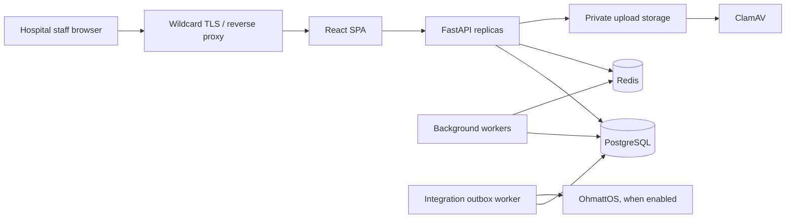

# Project Overview

## Purpose

HIS.Pro is a browser-based hospital information system for independent clinics,
hospitals, and multi-branch healthcare organizations. It provides one tenant
workspace for patient administration, clinical records, diagnostic orders,
pharmacy, billing, inventory, staffing, communications, and operational reports.

The application is designed around three priorities:

1. Tenant and branch isolation for health and financial data.
2. Responsive workflows under concurrent staff activity.
3. Horizontal scaling through stateless API replicas, PostgreSQL, Redis, durable
   workers, and transactional integration queues.

## Problems Addressed

- Fragmented patient, appointment, clinical, diagnostic, pharmacy, and billing data.
- Repeated manual entry between front desk, clinicians, laboratory, pharmacy,
  billing, and management.
- Duplicate records caused by double-clicks, retries, or concurrent workers.
- Weak visibility into queue, order, payment, stock, and audit state.
- Unsafe tenant URLs that embed mutable slugs in application paths.
- Migration from existing CSV/JSON exports into a tenant-scoped workspace.

## Target Users

| User | Implemented responsibilities |
|---|---|
| Facility administrator | Workspace, staff, modules, branches, settings, migration, audit, reporting |
| Branch administrator | Branch-scoped operations where the route explicitly permits it |
| Doctor | Consultation, records, prescriptions, diagnostic orders, appointments |
| Nurse | Patient/queue support, records, observations, wards, selected orders |
| Receptionist | Registration, appointments, queue, patient-facing administration |
| Billing Officer | Invoices, payments, receipts, and billing reports |
| Pharmacist | Medication catalogue, stock receipt, dispensing, inventory |
| Laboratory staff | Test catalogue, order processing, results |
| Patient/public visitor | Public hospital profile only; no patient self-service account is implemented |

The backend also references `RADIOLOGIST` and `STORE_KEEPER` permissions in a few
routes, but the staff creation contract and both frontends do not currently offer
those roles. This is an implementation gap, not a supported end-user role today.

## Core Technologies

| Layer | Current implementation |
|---|---|
| API | Python, FastAPI 0.104.1, Pydantic 2 |
| Persistence | SQLAlchemy 2, Alembic, PostgreSQL in production; SQLite for development/tests |
| Authentication | HS256 JWT access/refresh tokens plus durable user sessions and secure cookies |
| Cache/realtime | Redis 5 client, tenant-aware WebSocket broker |
| Background work | Database-backed job queue and integration outbox workers |
| Frontend | React 18, TypeScript, Vite, React Router, TanStack Query, Tailwind, Radix UI |
| Security scanning | ClamAV for production uploads when required |
| Deployment | Multi-stage Docker image, Docker Compose reference topology, Gunicorn/Uvicorn |
| External platform | Optional OhmattOS OAuth client-credentials integration behind feature flags |

## High-Level Architecture

## Product Boundary

HIS.Pro owns hospital-specific workflows, clinical and financial records, tenant
authorization, branch authorization, and the primary audit trail. OhmattOS is an
optional platform dependency for capabilities such as outbound notifications,
analytics, logs, and storage after its tenant-aware contract is production-ready.
HIS.Pro must continue enforcing `application_id + tenant_id` before every platform
call and may not delegate local authorization to OhmattOS.

## Current Maturity

Core hospital workflows are implemented and the project has active hardening for
idempotency, row locking, tenant URLs, CSRF, uploads, audit, workers, pagination,
and production configuration. It is not yet ready for unrestricted launch because
owner email verification, durable password reset, dependency remediation,
production migration/restore evidence, full browser role testing, and external
security validation remain open. See [Launch Readiness](12_LAUNCH_READINESS.md).

## AI Integrations

No production AI assistant, model API, clinical decision support model, or AI
diagnostic workflow is registered in the current backend or frontend. Any AI
claims would therefore be inaccurate.
