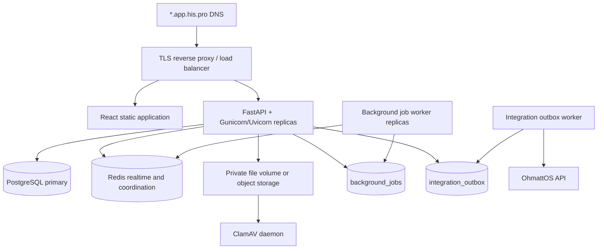
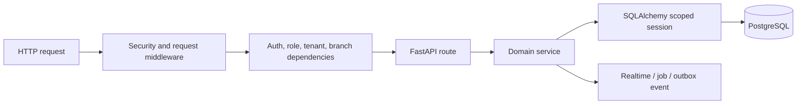
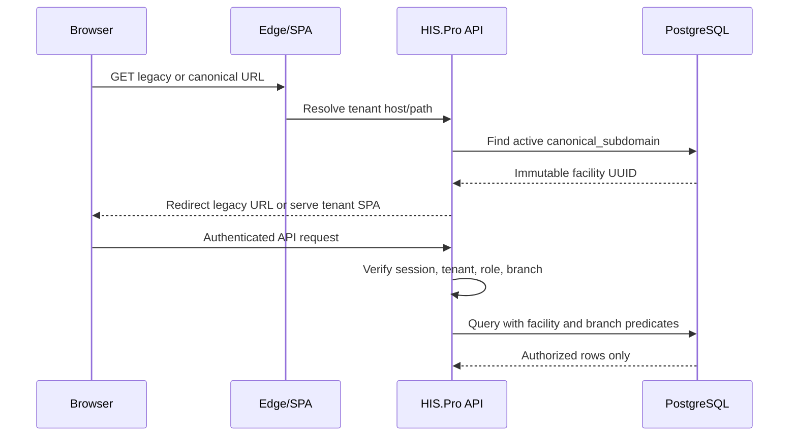
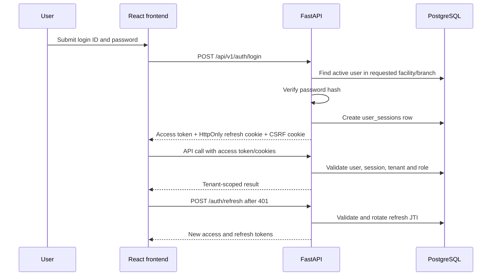

# System Architecture

## Runtime Topology



The API is intended to be stateless across replicas. Durable sessions,
idempotency records, jobs, and outbox events live in PostgreSQL; cross-replica
realtime delivery and worker heartbeats use Redis. The supplied Compose topology
uses a shared local volume, which is suitable for one host only. Multi-host
production requires tenant-prefixed object storage or a shared encrypted volume.

## Frontend Architecture

Two separate React applications are retained:

- `app/templates/initial frontend`: current product frontend and source of the
  present deployment flow.
- `app/templates/frontend-v2`: independent future UI/UX version with equivalent
  application routes and newer visual treatment.

Both use React Router for route composition, `AuthContext` for in-memory access
tokens and persisted non-secret user metadata, `TenantRoutingContext` for host
resolution, and TanStack Query for server state. `ProtectedRoute` applies a user
role guard and `ModuleRoute` hides disabled facility modules. These client guards
improve UX; backend role and tenant dependencies remain authoritative.

The API client:

- sends cookies with every request;
- adds CSRF headers for unsafe cookie-authenticated requests;
- generates a stable idempotency key for each unsafe action;
- performs one shared refresh-token request when access expires;
- reuses the original CSRF and idempotency headers on retry;
- normalizes user-visible errors without rendering backend exception details.

## Backend Architecture

FastAPI route modules validate Pydantic schemas and delegate reusable behavior to
services. SQLAlchemy uses a request-scoped synchronous session. Middleware handles
CORS, JWT parsing, module access, audit capture, CSRF, input/security headers,
rate limiting, metrics, database commit/rollback, and request timing.



Many route functions are declared `async` while using synchronous SQLAlchemy.
This works functionally but can block an event-loop worker under slow database
calls. Moving synchronous handlers to threadpool-backed `def` endpoints or
adopting SQLAlchemy async sessions is a scalability recommendation.

## Canonical Tenant Routing

The intended hospital URL is:

```text
https://<canonical-subdomain>.app.his.pro/dashboard
```

The subdomain resolves to an immutable facility UUID at the HIS.Pro boundary.
Legacy slug-in-path links continue to resolve and redirect to the canonical host.
The backend then authorizes user, facility UUID, and branch before querying data.



See [Tenant URL Migration](TENANT_URL_MIGRATION.md) for rollout details.

## Authentication Flow



Access tokens default to 30 minutes and refresh tokens to seven days. Refresh
tokens are rotated and bound to a durable session row. Logout can revoke one
session or every active session for the user.

## Authorization And Isolation

Authorization is layered:

1. JWT and session validation resolve a current active user.
2. Role dependencies restrict endpoint actions.
3. Facility scope constrains every exposed tenant record.
4. Branch helpers constrain branch-aware resources or deliberately deny access.
5. Module middleware and route checks ensure enabled product modules.
6. Tenant-mismatch lookups generally return `404`, reducing identifier disclosure.

The legacy insurance tables lack tenant columns and are not exposed by current
routers. They must remain unreachable until tenant isolation is added.

## Realtime And Cache Behavior

The frontend may reuse TanStack Query cache while a page remains fresh. Backend
mutations publish tenant/branch/user-filtered events. WebSocket subscribers can
invalidate or update relevant queries instead of every navigation forcing a new
read. Redis enables fanout across API replicas. Reconnect and initial-page fetches
remain necessary because WebSocket delivery is not a durable source of truth.

## Background Work

`background_jobs` implements leasing, retries, attempt limits, availability time,
and worker ownership. Data migration imports are queued here when inline execution
is disabled. `integration_outbox` records external OhmattOS deliveries in the same
database transaction as local state where used, then retries independently.

## External Integration

OhmattOS uses asymmetric `private_key_jwt` client authentication to obtain a
short-lived client-credentials token for one permitted tenant UUID and audience.
HIS.Pro does not use OAuth token exchange for ordinary service calls. The private
key must live in a secret manager/KMS, with rotation and emergency revocation.
Feature flags default off. See [OhmattOS Integration](ohmattos_integration.md).
