# Database Reference

> Generated from `Base.metadata` by `scripts/generate_code_reference_docs.py`.
> Application-level workflow validation is documented in
> [Modules and Workflows](06_MODULES_AND_WORKFLOWS.md).

## Conventions

All primary keys are 36-character UUID strings generated by the application.
Most records inherit `created_at` and `updated_at` from `BaseModel`.
`facility_id` is the immutable tenant identifier where present;
`facility_slug` remains for routing and compatibility. Nullable in this
reference means the database column permits null; route validation may be stricter.

## Entity Relationship Diagram

```mermaid
erDiagram
    appointments ||--o{ medical_records : "appointment_id"
    appointments ||--o{ patient_queues : "appointment_id"
    branches ||--o{ appointments : "branch_id"
    branches ||--o{ invoices : "branch_id"
    branches ||--o{ lab_orders : "branch_id"
    branches ||--o{ patient_queues : "branch_id"
    branches ||--o{ patients : "branch_id"
    branches ||--o{ prescriptions : "branch_id"
    branches ||--o{ radiology_orders : "branch_id"
    branches ||--o{ users : "branch_id"
    chat_conversations ||--o{ chat_messages : "conversation_id"
    facilities ||--o{ alerts : "facility_id"
    facilities ||--o{ alerts : "facility_slug"
    facilities ||--o{ appointments : "facility_id"
    facilities ||--o{ appointments : "facility_slug"
    facilities ||--o{ audit_logs : "facility_id"
    facilities ||--o{ audit_logs : "facility_slug"
    facilities ||--o{ background_jobs : "facility_id"
    facilities ||--o{ branches : "facility_id"
    facilities ||--o{ branches : "facility_slug"
    facilities ||--o{ chat_conversations : "facility_slug"
    facilities ||--o{ chat_messages : "facility_slug"
    facilities ||--o{ hospital_listings : "facility_slug"
    facilities ||--o{ integration_outbox : "facility_id"
    facilities ||--o{ inventory : "facility_id"
    facilities ||--o{ inventory : "facility_slug"
    facilities ||--o{ invoices : "facility_id"
    facilities ||--o{ invoices : "facility_slug"
    facilities ||--o{ lab_orders : "facility_id"
    facilities ||--o{ lab_orders : "facility_slug"
    facilities ||--o{ lab_tests : "facility_id"
    facilities ||--o{ lab_tests : "facility_slug"
    facilities ||--o{ medical_records : "facility_id"
    facilities ||--o{ medical_records : "facility_slug"
    facilities ||--o{ medications : "facility_id"
    facilities ||--o{ medications : "facility_slug"
    facilities ||--o{ order_workflow_events : "facility_id"
    facilities ||--o{ order_workflow_events : "facility_slug"
    facilities ||--o{ patient_notifications : "facility_id"
    facilities ||--o{ patient_notifications : "facility_slug"
    facilities ||--o{ patient_queues : "facility_id"
    facilities ||--o{ patient_queues : "facility_slug"
    facilities ||--o{ patients : "facility_id"
    facilities ||--o{ patients : "facility_slug"
    facilities ||--o{ prescriptions : "facility_id"
    facilities ||--o{ prescriptions : "facility_slug"
    facilities ||--o{ radiology_orders : "facility_id"
    facilities ||--o{ radiology_orders : "facility_slug"
    facilities ||--o{ referrals : "facility_id"
    facilities ||--o{ referrals : "facility_slug"
    facilities ||--o{ suppliers : "facility_id"
    facilities ||--o{ suppliers : "facility_slug"
    facilities ||--o{ users : "facility_id"
    facilities ||--o{ users : "facility_slug"
    facilities ||--o{ ward_admissions : "facility_id"
    facilities ||--o{ ward_admissions : "facility_slug"
    facilities ||--o{ ward_beds : "facility_id"
    facilities ||--o{ ward_beds : "facility_slug"
    facilities ||--o{ write_idempotency_records : "facility_id"
    facilities ||--o{ write_idempotency_records : "facility_slug"
    insurance_providers ||--o{ insurance_claims : "insurance_provider_id"
    invoices ||--o{ insurance_claims : "invoice_id"
    invoices ||--o{ invoice_items : "invoice_id"
    invoices ||--o{ payments : "invoice_id"
    lab_orders ||--o{ lab_results : "order_id"
    lab_tests ||--o{ lab_orders : "test_id"
    medical_records ||--o{ clinical_notes : "record_id"
    medications ||--o{ pharmacy_inventory : "medication_id"
    medications ||--o{ prescription_items : "medication_id"
    patients ||--o{ appointments : "patient_id"
    patients ||--o{ clinical_notes : "patient_id"
    patients ||--o{ invoices : "patient_id"
    patients ||--o{ lab_orders : "patient_id"
    patients ||--o{ medical_records : "patient_id"
    patients ||--o{ order_workflow_events : "patient_id"
    patients ||--o{ patient_notifications : "patient_id"
    patients ||--o{ patient_queues : "patient_id"
    patients ||--o{ prescriptions : "patient_id"
    patients ||--o{ radiology_orders : "patient_id"
    patients ||--o{ referrals : "patient_id"
    patients ||--o{ ward_admissions : "patient_id"
    prescriptions ||--o{ prescription_items : "prescription_id"
    suppliers ||--o{ inventory : "supplier_id"
    users ||--o{ alerts : "recipient_id"
    users ||--o{ appointments : "doctor_id"
    users ||--o{ audit_logs : "user_id"
    users ||--o{ background_jobs : "requested_by_user_id"
    users ||--o{ chat_messages : "sender_id"
    users ||--o{ clinical_notes : "created_by"
    users ||--o{ lab_orders : "ordered_by"
    users ||--o{ lab_orders : "performed_by"
    users ||--o{ medical_records : "created_by"
    users ||--o{ medical_records : "voided_by"
    users ||--o{ order_workflow_events : "actor_id"
    users ||--o{ patients : "created_by"
    users ||--o{ prescriptions : "dispensed_by"
    users ||--o{ prescriptions : "prescribed_by"
    users ||--o{ radiology_orders : "radiologist_id"
    users ||--o{ radiology_orders : "requested_by"
    users ||--o{ referrals : "accepted_by"
    users ||--o{ referrals : "completed_by"
    users ||--o{ referrals : "created_by"
    users ||--o{ user_sessions : "user_id"
    users ||--o{ ward_admissions : "admitted_by"
    users ||--o{ write_idempotency_records : "actor_id"
    ward_beds ||--o{ ward_admissions : "bed_id"
```

## Tables

### `alerts`

Facility-scoped staff alerts and read state.

| Field | Type | Null | Key / relationship | Default |
|---|---|---:|---|---|
| `facility_id` | `VARCHAR(36)` | yes | FK -> `facilities.id` | - |
| `facility_slug` | `VARCHAR(100)` | no | FK -> `facilities.slug` | - |
| `alert_type` | `VARCHAR(50)` | no | - | - |
| `title` | `VARCHAR(200)` | no | - | - |
| `message` | `TEXT` | no | - | - |
| `recipient_id` | `VARCHAR(36)` | yes | FK -> `users.id` | - |
| `is_read` | `BOOLEAN` | yes | - | False |
| `read_at` | `DATETIME` | yes | - | - |
| `expires_at` | `DATETIME` | yes | - | - |
| `id` | `VARCHAR(36)` | no | PK | <lambda> |
| `created_at` | `DATETIME` | yes | - | utc_now |
| `updated_at` | `DATETIME` | yes | - | utc_now |

**Indexes and constraints**

- `idx_alerts_facility_created`: index on `facility_slug`, `created_at`.
- `idx_alerts_facility_recipient_unread`: index on `facility_slug`, `recipient_id`, `is_read`.
- `idx_alerts_facility_unread`: index on `facility_slug`, `is_read`, `expires_at`.
- `ix_alerts_alert_type`: index on `alert_type`.
- `ix_alerts_created_at`: index on `created_at`.
- `ix_alerts_facility_id`: index on `facility_id`.
- `ix_alerts_facility_slug`: index on `facility_slug`.
- `ix_alerts_is_read`: index on `is_read`.
- `ix_alerts_recipient_id`: index on `recipient_id`.

**Relationships**

- `facility_id` references `facilities.id`.
- `facility_slug` references `facilities.slug`.
- `recipient_id` references `users.id`.

**Database-enforced validation**

- Required on insert: `facility_slug`, `alert_type`, `title`, `message`.
- String lengths, foreign keys, unique indexes, and nullability are enforced as listed above.

### `appointments`

Scheduled patient visits and their workflow status.

| Field | Type | Null | Key / relationship | Default |
|---|---|---:|---|---|
| `patient_id` | `VARCHAR(36)` | no | FK -> `patients.id` | - |
| `doctor_id` | `VARCHAR(36)` | no | FK -> `users.id` | - |
| `facility_id` | `VARCHAR(36)` | yes | FK -> `facilities.id` | - |
| `facility_slug` | `VARCHAR(100)` | yes | FK -> `facilities.slug` | - |
| `department_id` | `VARCHAR(36)` | yes | - | - |
| `branch_id` | `VARCHAR(36)` | yes | FK -> `branches.id` | - |
| `appointment_date` | `DATETIME` | no | - | - |
| `scheduled_time` | `DATETIME` | yes | - | - |
| `duration_minutes` | `INTEGER` | yes | - | 30 |
| `status` | `VARCHAR(50)` | yes | - | SCHEDULED |
| `reason` | `TEXT` | yes | - | - |
| `notes` | `TEXT` | yes | - | - |
| `idempotency_key` | `VARCHAR(200)` | yes | - | - |
| `idempotency_payload_hash` | `VARCHAR(64)` | yes | - | - |
| `id` | `VARCHAR(36)` | no | PK | <lambda> |
| `created_at` | `DATETIME` | yes | - | utc_now |
| `updated_at` | `DATETIME` | yes | - | utc_now |

**Indexes and constraints**

- `idx_appointments_facility_branch`: index on `facility_slug`, `branch_id`.
- `idx_appointments_facility_date`: index on `facility_slug`, `appointment_date`.
- `idx_appointments_facility_dept`: index on `facility_slug`, `department_id`.
- `idx_appointments_facility_doctor_date`: index on `facility_slug`, `doctor_id`, `appointment_date`.
- `idx_appointments_status_facility`: index on `status`, `facility_slug`.
- `ix_appointments_appointment_date`: index on `appointment_date`.
- `ix_appointments_branch_id`: index on `branch_id`.
- `ix_appointments_created_at`: index on `created_at`.
- `ix_appointments_department_id`: index on `department_id`.
- `ix_appointments_doctor_id`: index on `doctor_id`.
- `ix_appointments_facility_id`: index on `facility_id`.
- `ix_appointments_facility_slug`: index on `facility_slug`.
- `ix_appointments_patient_id`: index on `patient_id`.
- `ix_appointments_scheduled_time`: index on `scheduled_time`.
- `ix_appointments_status`: index on `status`.
- `uq_appointments_facility_idempotency`: unique index on `facility_slug`, `idempotency_key`.

**Relationships**

- `branch_id` references `branches.id`.
- `doctor_id` references `users.id`.
- `facility_id` references `facilities.id`.
- `facility_slug` references `facilities.slug`.
- `patient_id` references `patients.id`.

**Database-enforced validation**

- Required on insert: `patient_id`, `doctor_id`, `appointment_date`.
- String lengths, foreign keys, unique indexes, and nullability are enforced as listed above.

### `audit_logs`

Tenant-scoped security and business audit events.

| Field | Type | Null | Key / relationship | Default |
|---|---|---:|---|---|
| `user_id` | `VARCHAR(36)` | yes | FK -> `users.id` | - |
| `action` | `VARCHAR(100)` | no | - | - |
| `resource_type` | `VARCHAR(50)` | yes | - | - |
| `resource_id` | `VARCHAR(36)` | yes | - | - |
| `facility_id` | `VARCHAR(36)` | yes | FK -> `facilities.id` | - |
| `facility_slug` | `VARCHAR(100)` | yes | FK -> `facilities.slug` | - |
| `details` | `JSON` | yes | - | dict |
| `ip_address` | `VARCHAR(45)` | yes | - | - |
| `user_agent` | `VARCHAR(500)` | yes | - | - |
| `id` | `VARCHAR(36)` | no | PK | <lambda> |
| `created_at` | `DATETIME` | yes | - | utc_now |
| `updated_at` | `DATETIME` | yes | - | utc_now |

**Indexes and constraints**

- `idx_audit_logs_facility_action_created`: index on `facility_slug`, `action`, `created_at`.
- `idx_audit_logs_facility_created`: index on `facility_slug`, `created_at`.
- `idx_audit_logs_facility_resource_created`: index on `facility_slug`, `resource_type`, `resource_id`, `created_at`.
- `idx_audit_logs_facility_user_created`: index on `facility_slug`, `user_id`, `created_at`.
- `ix_audit_logs_created_at`: index on `created_at`.
- `ix_audit_logs_facility_id`: index on `facility_id`.
- `ix_audit_logs_facility_slug`: index on `facility_slug`.

**Relationships**

- `facility_id` references `facilities.id`.
- `facility_slug` references `facilities.slug`.
- `user_id` references `users.id`.

**Database-enforced validation**

- Required on insert: `action`.
- String lengths, foreign keys, unique indexes, and nullability are enforced as listed above.

### `background_jobs`

Durable jobs claimed by asynchronous workers.

| Field | Type | Null | Key / relationship | Default |
|---|---|---:|---|---|
| `name` | `VARCHAR(100)` | no | - | - |
| `facility_id` | `VARCHAR(36)` | no | FK -> `facilities.id` | - |
| `requested_by_user_id` | `VARCHAR(36)` | no | FK -> `users.id` | - |
| `idempotency_key` | `VARCHAR(200)` | no | - | - |
| `payload_json` | `JSON` | no | - | - |
| `status` | `VARCHAR(20)` | no | - | QUEUED |
| `attempts` | `INTEGER` | no | - | 0 |
| `max_attempts` | `INTEGER` | no | - | 3 |
| `available_at` | `DATETIME` | no | - | utc_now |
| `locked_at` | `DATETIME` | yes | - | - |
| `lock_owner` | `VARCHAR(160)` | yes | - | - |
| `result_json` | `JSON` | yes | - | - |
| `error` | `TEXT` | yes | - | - |
| `external_job_id` | `VARCHAR(200)` | yes | - | - |
| `id` | `VARCHAR(36)` | no | PK | <lambda> |
| `created_at` | `DATETIME` | yes | - | utc_now |
| `updated_at` | `DATETIME` | yes | - | utc_now |

**Indexes and constraints**

- `idx_background_jobs_claim`: index on `status`, `available_at`, `created_at`.
- `idx_background_jobs_lease`: index on `status`, `locked_at`.
- `idx_background_jobs_tenant_status`: index on `facility_id`, `status`, `created_at`.
- `ix_background_jobs_created_at`: index on `created_at`.
- `ix_background_jobs_facility_id`: index on `facility_id`.
- `ix_background_jobs_requested_by_user_id`: index on `requested_by_user_id`.
- `uq_background_jobs_tenant_name_idempotency`: unique across `facility_id`, `name`, `idempotency_key`.

**Relationships**

- `facility_id` references `facilities.id`.
- `requested_by_user_id` references `users.id`.

**Database-enforced validation**

- Required on insert: `name`, `facility_id`, `requested_by_user_id`, `idempotency_key`, `payload_json`.
- String lengths, foreign keys, unique indexes, and nullability are enforced as listed above.

### `branches`

Optional facility branch definitions, modules, and settings.

| Field | Type | Null | Key / relationship | Default |
|---|---|---:|---|---|
| `facility_id` | `VARCHAR(36)` | no | FK -> `facilities.id` | - |
| `facility_slug` | `VARCHAR(100)` | no | FK -> `facilities.slug` | - |
| `name` | `VARCHAR(160)` | no | - | - |
| `slug` | `VARCHAR(120)` | no | - | - |
| `location` | `TEXT` | yes | - | - |
| `address` | `TEXT` | yes | - | - |
| `phone` | `VARCHAR(30)` | yes | - | - |
| `email` | `VARCHAR(120)` | yes | - | - |
| `modules` | `JSON` | yes | - | list |
| `settings` | `JSON` | yes | - | dict |
| `is_public` | `BOOLEAN` | yes | - | False |
| `is_active` | `BOOLEAN` | yes | - | True |
| `id` | `VARCHAR(36)` | no | PK | <lambda> |
| `created_at` | `DATETIME` | yes | - | utc_now |
| `updated_at` | `DATETIME` | yes | - | utc_now |

**Indexes and constraints**

- `ix_branches_created_at`: index on `created_at`.
- `ix_branches_facility_id`: index on `facility_id`.
- `ix_branches_facility_slug`: index on `facility_slug`.
- `ix_branches_slug`: index on `slug`.
- `uq_branch_facility_slug`: unique across `facility_slug`, `slug`.

**Relationships**

- `facility_id` references `facilities.id`.
- `facility_slug` references `facilities.slug`.

**Database-enforced validation**

- Required on insert: `facility_id`, `facility_slug`, `name`, `slug`.
- String lengths, foreign keys, unique indexes, and nullability are enforced as listed above.

### `chat_conversations`

Two-person staff conversations within a facility.

| Field | Type | Null | Key / relationship | Default |
|---|---|---:|---|---|
| `facility_slug` | `VARCHAR(100)` | no | FK -> `facilities.slug` | - |
| `participant_ids` | `JSON` | no | - | list |
| `participant_key` | `VARCHAR(80)` | yes | - | - |
| `last_message_at` | `DATETIME` | yes | - | utcnow |
| `id` | `VARCHAR(36)` | no | PK | <lambda> |
| `created_at` | `DATETIME` | yes | - | utc_now |
| `updated_at` | `DATETIME` | yes | - | utc_now |

**Indexes and constraints**

- `idx_chat_conversations_facility_last_message`: index on `facility_slug`, `last_message_at`.
- `idx_chat_conversations_facility_participant`: unique index on `facility_slug`, `participant_key`.
- `ix_chat_conversations_created_at`: index on `created_at`.
- `ix_chat_conversations_facility_slug`: index on `facility_slug`.
- `ix_chat_conversations_last_message_at`: index on `last_message_at`.

**Relationships**

- `facility_slug` references `facilities.slug`.

**Database-enforced validation**

- Required on insert: `facility_slug`.
- String lengths, foreign keys, unique indexes, and nullability are enforced as listed above.

### `chat_messages`

Messages and private attachment references in staff chat.

| Field | Type | Null | Key / relationship | Default |
|---|---|---:|---|---|
| `conversation_id` | `VARCHAR(36)` | no | FK -> `chat_conversations.id` | - |
| `facility_slug` | `VARCHAR(100)` | no | FK -> `facilities.slug` | - |
| `sender_id` | `VARCHAR(36)` | no | FK -> `users.id` | - |
| `content` | `TEXT` | yes | - | - |
| `message_type` | `VARCHAR(20)` | no | - | text |
| `file_name` | `VARCHAR(255)` | yes | - | - |
| `file_url` | `VARCHAR(500)` | yes | - | - |
| `file_size` | `INTEGER` | yes | - | - |
| `file_type` | `VARCHAR(120)` | yes | - | - |
| `is_read` | `BOOLEAN` | no | - | False |
| `read_at` | `DATETIME` | yes | - | - |
| `id` | `VARCHAR(36)` | no | PK | <lambda> |
| `created_at` | `DATETIME` | yes | - | utc_now |
| `updated_at` | `DATETIME` | yes | - | utc_now |

**Indexes and constraints**

- `idx_chat_messages_conversation_created`: index on `facility_slug`, `conversation_id`, `created_at`.
- `idx_chat_messages_unread`: index on `facility_slug`, `conversation_id`, `is_read`, `sender_id`.
- `ix_chat_messages_conversation_id`: index on `conversation_id`.
- `ix_chat_messages_created_at`: index on `created_at`.
- `ix_chat_messages_facility_slug`: index on `facility_slug`.
- `ix_chat_messages_sender_id`: index on `sender_id`.

**Relationships**

- `conversation_id` references `chat_conversations.id`.
- `facility_slug` references `facilities.slug`.
- `sender_id` references `users.id`.

**Database-enforced validation**

- Required on insert: `conversation_id`, `facility_slug`, `sender_id`.
- String lengths, foreign keys, unique indexes, and nullability are enforced as listed above.

### `clinical_notes`

Structured or narrative notes attached to a medical record.

| Field | Type | Null | Key / relationship | Default |
|---|---|---:|---|---|
| `patient_id` | `VARCHAR(36)` | no | FK -> `patients.id` | - |
| `record_id` | `VARCHAR(36)` | yes | FK -> `medical_records.id` | - |
| `created_by` | `VARCHAR(36)` | yes | FK -> `users.id` | - |
| `note_type` | `VARCHAR(50)` | yes | - | - |
| `title` | `VARCHAR(200)` | yes | - | - |
| `content` | `TEXT` | no | - | - |
| `is_confidential` | `BOOLEAN` | yes | - | False |
| `id` | `VARCHAR(36)` | no | PK | <lambda> |
| `created_at` | `DATETIME` | yes | - | utc_now |
| `updated_at` | `DATETIME` | yes | - | utc_now |

**Indexes and constraints**

- `idx_clinical_notes_patient_created`: index on `patient_id`, `created_at`.
- `idx_clinical_notes_record_created`: index on `record_id`, `created_at`.
- `ix_clinical_notes_created_at`: index on `created_at`.

**Relationships**

- `created_by` references `users.id`.
- `patient_id` references `patients.id`.
- `record_id` references `medical_records.id`.

**Database-enforced validation**

- Required on insert: `patient_id`, `content`.
- String lengths, foreign keys, unique indexes, and nullability are enforced as listed above.

### `facilities`

Top-level hospital or clinic tenant records.

| Field | Type | Null | Key / relationship | Default |
|---|---|---:|---|---|
| `name` | `VARCHAR(200)` | no | - | - |
| `type` | `VARCHAR(50)` | no | - | - |
| `slug` | `VARCHAR(100)` | no | UNIQUE | - |
| `canonical_subdomain` | `VARCHAR(63)` | no | UNIQUE | - |
| `country` | `VARCHAR(100)` | yes | - | - |
| `address` | `TEXT` | yes | - | - |
| `phone` | `VARCHAR(20)` | yes | - | - |
| `email` | `VARCHAR(120)` | yes | - | - |
| `hospital_type` | `VARCHAR(20)` | yes | - | single |
| `departments` | `JSON` | yes | - | list |
| `modules` | `JSON` | yes | - | list |
| `settings` | `JSON` | yes | - | dict |
| `is_active` | `BOOLEAN` | yes | - | True |
| `id` | `VARCHAR(36)` | no | PK | <lambda> |
| `created_at` | `DATETIME` | yes | - | utc_now |
| `updated_at` | `DATETIME` | yes | - | utc_now |

**Indexes and constraints**

- `ix_facilities_canonical_subdomain`: unique index on `canonical_subdomain`.
- `ix_facilities_created_at`: index on `created_at`.
- `ix_facilities_slug`: unique index on `slug`.

**Database-enforced validation**

- Required on insert: `name`, `type`, `slug`, `canonical_subdomain`.
- String lengths, foreign keys, unique indexes, and nullability are enforced as listed above.

### `hospital_listings`

Public directory profile content for a facility.

| Field | Type | Null | Key / relationship | Default |
|---|---|---:|---|---|
| `facility_slug` | `VARCHAR(100)` | no | UNIQUE, FK -> `facilities.slug` | - |
| `is_public` | `BOOLEAN` | yes | - | False |
| `display_name` | `VARCHAR(200)` | no | - | - |
| `description` | `TEXT` | yes | - | - |
| `phone` | `VARCHAR(20)` | yes | - | - |
| `email` | `VARCHAR(120)` | yes | - | - |
| `photos` | `JSON` | yes | - | list |
| `department_profiles` | `JSON` | yes | - | dict |
| `id` | `VARCHAR(36)` | no | PK | <lambda> |
| `created_at` | `DATETIME` | yes | - | utc_now |
| `updated_at` | `DATETIME` | yes | - | utc_now |

**Indexes and constraints**

- `ix_hospital_listings_created_at`: index on `created_at`.
- `ix_hospital_listings_facility_slug`: unique index on `facility_slug`.

**Relationships**

- `facility_slug` references `facilities.slug`.

**Database-enforced validation**

- Required on insert: `facility_slug`, `display_name`.
- String lengths, foreign keys, unique indexes, and nullability are enforced as listed above.

### `insurance_claims`

Legacy insurance claim records linked to invoices.

| Field | Type | Null | Key / relationship | Default |
|---|---|---:|---|---|
| `invoice_id` | `VARCHAR(36)` | no | FK -> `invoices.id` | - |
| `insurance_provider_id` | `VARCHAR(36)` | yes | FK -> `insurance_providers.id` | - |
| `policy_number` | `VARCHAR(100)` | yes | - | - |
| `claim_number` | `VARCHAR(50)` | yes | UNIQUE | - |
| `claimed_amount` | `NUMERIC(10, 2)` | yes | - | 0 |
| `approved_amount` | `NUMERIC(10, 2)` | yes | - | 0 |
| `status` | `VARCHAR(50)` | yes | - | PENDING |
| `claim_date` | `DATETIME` | yes | - | - |
| `settlement_date` | `DATETIME` | yes | - | - |
| `id` | `VARCHAR(36)` | no | PK | <lambda> |
| `created_at` | `DATETIME` | yes | - | utc_now |
| `updated_at` | `DATETIME` | yes | - | utc_now |

**Indexes and constraints**

- `ix_insurance_claims_created_at`: index on `created_at`.
- `unnamed unique constraint`: unique across `claim_number`.

**Relationships**

- `insurance_provider_id` references `insurance_providers.id`.
- `invoice_id` references `invoices.id`.

**Database-enforced validation**

- Required on insert: `invoice_id`.
- String lengths, foreign keys, unique indexes, and nullability are enforced as listed above.

### `insurance_providers`

Legacy insurance provider catalogue.

| Field | Type | Null | Key / relationship | Default |
|---|---|---:|---|---|
| `name` | `VARCHAR(200)` | no | - | - |
| `code` | `VARCHAR(50)` | no | UNIQUE | - |
| `contact_number` | `VARCHAR(20)` | yes | - | - |
| `email` | `VARCHAR(120)` | yes | - | - |
| `address` | `TEXT` | yes | - | - |
| `is_active` | `BOOLEAN` | yes | - | True |
| `id` | `VARCHAR(36)` | no | PK | <lambda> |
| `created_at` | `DATETIME` | yes | - | utc_now |
| `updated_at` | `DATETIME` | yes | - | utc_now |

**Indexes and constraints**

- `ix_insurance_providers_created_at`: index on `created_at`.
- `unnamed unique constraint`: unique across `code`.

**Database-enforced validation**

- Required on insert: `name`, `code`.
- String lengths, foreign keys, unique indexes, and nullability are enforced as listed above.

### `integration_outbox`

Transactional OhmattOS delivery queue.

| Field | Type | Null | Key / relationship | Default |
|---|---|---:|---|---|
| `facility_id` | `VARCHAR(36)` | no | FK -> `facilities.id` | - |
| `destination` | `VARCHAR(40)` | no | - | - |
| `event_type` | `VARCHAR(100)` | no | - | - |
| `aggregate_type` | `VARCHAR(80)` | yes | - | - |
| `aggregate_id` | `VARCHAR(36)` | yes | - | - |
| `idempotency_key` | `VARCHAR(200)` | no | - | - |
| `correlation_id` | `VARCHAR(36)` | no | - | - |
| `payload_json` | `JSON` | no | - | - |
| `status` | `VARCHAR(20)` | no | - | QUEUED |
| `attempts` | `INTEGER` | no | - | 0 |
| `max_attempts` | `INTEGER` | no | - | 8 |
| `available_at` | `DATETIME` | no | - | utc_now |
| `locked_at` | `DATETIME` | yes | - | - |
| `lock_owner` | `VARCHAR(160)` | yes | - | - |
| `delivered_at` | `DATETIME` | yes | - | - |
| `last_error_code` | `VARCHAR(80)` | yes | - | - |
| `id` | `VARCHAR(36)` | no | PK | <lambda> |
| `created_at` | `DATETIME` | yes | - | utc_now |
| `updated_at` | `DATETIME` | yes | - | utc_now |

**Indexes and constraints**

- `idx_integration_outbox_dispatch`: index on `destination`, `status`, `available_at`, `created_at`.
- `idx_integration_outbox_lease`: index on `status`, `locked_at`.
- `idx_integration_outbox_tenant_status`: index on `facility_id`, `status`, `created_at`.
- `ix_integration_outbox_created_at`: index on `created_at`.
- `ix_integration_outbox_facility_id`: index on `facility_id`.
- `uq_integration_outbox_destination_tenant_idempotency`: unique across `destination`, `facility_id`, `idempotency_key`.

**Relationships**

- `facility_id` references `facilities.id`.

**Database-enforced validation**

- Required on insert: `facility_id`, `destination`, `event_type`, `idempotency_key`, `correlation_id`, `payload_json`.
- String lengths, foreign keys, unique indexes, and nullability are enforced as listed above.

### `inventory`

Facility medical supply and equipment stock catalogue.

| Field | Type | Null | Key / relationship | Default |
|---|---|---:|---|---|
| `facility_id` | `VARCHAR(36)` | yes | FK -> `facilities.id` | - |
| `facility_slug` | `VARCHAR(100)` | no | FK -> `facilities.slug` | - |
| `name` | `VARCHAR(200)` | no | - | - |
| `sku` | `VARCHAR(100)` | no | - | - |
| `category` | `VARCHAR(50)` | no | - | - |
| `unit` | `VARCHAR(50)` | no | - | - |
| `reorder_level` | `INTEGER` | yes | - | 0 |
| `reorder_quantity` | `INTEGER` | yes | - | 0 |
| `current_stock` | `INTEGER` | yes | - | 0 |
| `expiry_date` | `DATE` | yes | - | - |
| `supplier_id` | `VARCHAR(36)` | yes | FK -> `suppliers.id` | - |
| `unit_cost` | `NUMERIC(10, 2)` | yes | - | 0.00 |
| `is_active` | `BOOLEAN` | yes | - | True |
| `id` | `VARCHAR(36)` | no | PK | <lambda> |
| `created_at` | `DATETIME` | yes | - | utc_now |
| `updated_at` | `DATETIME` | yes | - | utc_now |

**Indexes and constraints**

- `idx_inventory_facility_active`: index on `facility_slug`, `is_active`.
- `idx_inventory_facility_category_active`: index on `facility_slug`, `category`, `is_active`.
- `idx_inventory_facility_sku`: index on `facility_slug`, `sku`.
- `ix_inventory_created_at`: index on `created_at`.
- `ix_inventory_facility_id`: index on `facility_id`.
- `ix_inventory_facility_slug`: index on `facility_slug`.
- `uq_inventory_active_facility_sku`: unique index on `facility_slug`, `sku` where `is_active = true`.

**Relationships**

- `facility_id` references `facilities.id`.
- `facility_slug` references `facilities.slug`.
- `supplier_id` references `suppliers.id`.

**Database-enforced validation**

- Required on insert: `facility_slug`, `name`, `sku`, `category`, `unit`.
- String lengths, foreign keys, unique indexes, and nullability are enforced as listed above.

### `invoice_items`

Line items belonging to an invoice.

| Field | Type | Null | Key / relationship | Default |
|---|---|---:|---|---|
| `invoice_id` | `VARCHAR(36)` | no | FK -> `invoices.id` | - |
| `description` | `VARCHAR(500)` | no | - | - |
| `quantity` | `INTEGER` | yes | - | 1 |
| `unit_price` | `NUMERIC(10, 2)` | yes | - | 0 |
| `total` | `NUMERIC(10, 2)` | yes | - | 0 |
| `id` | `VARCHAR(36)` | no | PK | <lambda> |
| `created_at` | `DATETIME` | yes | - | utc_now |
| `updated_at` | `DATETIME` | yes | - | utc_now |

**Indexes and constraints**

- `ix_invoice_items_created_at`: index on `created_at`.
- `ix_invoice_items_invoice_id`: index on `invoice_id`.

**Relationships**

- `invoice_id` references `invoices.id`.

**Database-enforced validation**

- Required on insert: `invoice_id`, `description`.
- String lengths, foreign keys, unique indexes, and nullability are enforced as listed above.

### `invoices`

Tenant- and branch-scoped patient invoices.

| Field | Type | Null | Key / relationship | Default |
|---|---|---:|---|---|
| `patient_id` | `VARCHAR(36)` | no | FK -> `patients.id` | - |
| `invoice_number` | `VARCHAR(50)` | no | UNIQUE | - |
| `facility_id` | `VARCHAR(36)` | yes | FK -> `facilities.id` | - |
| `facility_slug` | `VARCHAR(100)` | yes | FK -> `facilities.slug` | - |
| `department_id` | `VARCHAR(36)` | yes | - | - |
| `branch_id` | `VARCHAR(36)` | yes | FK -> `branches.id` | - |
| `status` | `VARCHAR(50)` | yes | - | PENDING |
| `subtotal` | `NUMERIC(10, 2)` | yes | - | 0 |
| `tax` | `NUMERIC(10, 2)` | yes | - | 0 |
| `discount` | `NUMERIC(10, 2)` | yes | - | 0 |
| `total` | `NUMERIC(10, 2)` | yes | - | 0 |
| `notes` | `TEXT` | yes | - | - |
| `due_date` | `DATE` | yes | - | - |
| `invoice_date` | `DATETIME` | no | - | - |
| `paid_date` | `DATETIME` | yes | - | - |
| `idempotency_key` | `VARCHAR(200)` | yes | - | - |
| `idempotency_payload_hash` | `VARCHAR(64)` | yes | - | - |
| `id` | `VARCHAR(36)` | no | PK | <lambda> |
| `created_at` | `DATETIME` | yes | - | utc_now |
| `updated_at` | `DATETIME` | yes | - | utc_now |

**Indexes and constraints**

- `idx_invoices_facility_branch`: index on `facility_slug`, `branch_id`.
- `idx_invoices_facility_date`: index on `facility_slug`, `invoice_date`.
- `idx_invoices_facility_dept`: index on `facility_slug`, `department_id`.
- `idx_invoices_facility_patient`: index on `facility_slug`, `patient_id`.
- `idx_invoices_status_facility`: index on `status`, `facility_slug`.
- `ix_invoices_branch_id`: index on `branch_id`.
- `ix_invoices_created_at`: index on `created_at`.
- `ix_invoices_department_id`: index on `department_id`.
- `ix_invoices_facility_id`: index on `facility_id`.
- `ix_invoices_facility_slug`: index on `facility_slug`.
- `ix_invoices_invoice_date`: index on `invoice_date`.
- `ix_invoices_paid_date`: index on `paid_date`.
- `ix_invoices_patient_id`: index on `patient_id`.
- `ix_invoices_status`: index on `status`.
- `uq_invoices_facility_idempotency`: unique index on `facility_slug`, `idempotency_key`.
- `unnamed unique constraint`: unique across `invoice_number`.

**Relationships**

- `branch_id` references `branches.id`.
- `facility_id` references `facilities.id`.
- `facility_slug` references `facilities.slug`.
- `patient_id` references `patients.id`.

**Database-enforced validation**

- Required on insert: `patient_id`, `invoice_number`, `invoice_date`.
- String lengths, foreign keys, unique indexes, and nullability are enforced as listed above.

### `lab_orders`

Patient laboratory test orders and workflow state.

| Field | Type | Null | Key / relationship | Default |
|---|---|---:|---|---|
| `patient_id` | `VARCHAR(36)` | no | FK -> `patients.id` | - |
| `test_id` | `VARCHAR(36)` | no | FK -> `lab_tests.id` | - |
| `facility_id` | `VARCHAR(36)` | yes | FK -> `facilities.id` | - |
| `facility_slug` | `VARCHAR(100)` | yes | FK -> `facilities.slug` | - |
| `department_id` | `VARCHAR(36)` | yes | - | - |
| `branch_id` | `VARCHAR(36)` | yes | FK -> `branches.id` | - |
| `ordered_by` | `VARCHAR(36)` | yes | FK -> `users.id` | - |
| `performed_by` | `VARCHAR(36)` | yes | FK -> `users.id` | - |
| `status` | `VARCHAR(50)` | yes | - | PENDING |
| `priority` | `VARCHAR(20)` | yes | - | ROUTINE |
| `notes` | `TEXT` | yes | - | - |
| `idempotency_key` | `VARCHAR(200)` | yes | - | - |
| `idempotency_payload_hash` | `VARCHAR(64)` | yes | - | - |
| `order_date` | `DATETIME` | no | - | - |
| `collection_date` | `DATETIME` | yes | - | - |
| `completed_date` | `DATETIME` | yes | - | - |
| `id` | `VARCHAR(36)` | no | PK | <lambda> |
| `created_at` | `DATETIME` | yes | - | utc_now |
| `updated_at` | `DATETIME` | yes | - | utc_now |

**Indexes and constraints**

- `idx_lab_orders_facility_branch`: index on `facility_slug`, `branch_id`.
- `idx_lab_orders_facility_date`: index on `facility_slug`, `order_date`.
- `idx_lab_orders_facility_dept`: index on `facility_slug`, `department_id`.
- `idx_lab_orders_facility_patient`: index on `facility_slug`, `patient_id`.
- `idx_lab_orders_status_facility`: index on `status`, `facility_slug`.
- `ix_lab_orders_branch_id`: index on `branch_id`.
- `ix_lab_orders_created_at`: index on `created_at`.
- `ix_lab_orders_department_id`: index on `department_id`.
- `ix_lab_orders_facility_id`: index on `facility_id`.
- `ix_lab_orders_facility_slug`: index on `facility_slug`.
- `ix_lab_orders_order_date`: index on `order_date`.
- `ix_lab_orders_patient_id`: index on `patient_id`.
- `ix_lab_orders_status`: index on `status`.
- `uq_lab_orders_facility_idempotency`: unique index on `facility_slug`, `idempotency_key`.

**Relationships**

- `branch_id` references `branches.id`.
- `facility_id` references `facilities.id`.
- `facility_slug` references `facilities.slug`.
- `ordered_by` references `users.id`.
- `patient_id` references `patients.id`.
- `performed_by` references `users.id`.
- `test_id` references `lab_tests.id`.

**Database-enforced validation**

- Required on insert: `patient_id`, `test_id`, `order_date`.
- String lengths, foreign keys, unique indexes, and nullability are enforced as listed above.

### `lab_results`

Results attached one-to-one to laboratory orders.

| Field | Type | Null | Key / relationship | Default |
|---|---|---:|---|---|
| `order_id` | `VARCHAR(36)` | no | FK -> `lab_orders.id` | - |
| `value` | `VARCHAR(100)` | yes | - | - |
| `is_abnormal` | `BOOLEAN` | yes | - | False |
| `notes` | `TEXT` | yes | - | - |
| `result_date` | `DATETIME` | yes | - | - |
| `id` | `VARCHAR(36)` | no | PK | <lambda> |
| `created_at` | `DATETIME` | yes | - | utc_now |
| `updated_at` | `DATETIME` | yes | - | utc_now |

**Indexes and constraints**

- `ix_lab_results_created_at`: index on `created_at`.
- `ix_lab_results_order_id`: index on `order_id`.
- `uq_lab_results_order`: unique index on `order_id`.

**Relationships**

- `order_id` references `lab_orders.id`.

**Database-enforced validation**

- Required on insert: `order_id`.
- String lengths, foreign keys, unique indexes, and nullability are enforced as listed above.

### `lab_tests`

Facility-scoped laboratory test catalogue.

| Field | Type | Null | Key / relationship | Default |
|---|---|---:|---|---|
| `name` | `VARCHAR(200)` | no | - | - |
| `code` | `VARCHAR(50)` | no | - | - |
| `facility_id` | `VARCHAR(36)` | yes | FK -> `facilities.id` | - |
| `facility_slug` | `VARCHAR(100)` | yes | FK -> `facilities.slug` | - |
| `description` | `TEXT` | yes | - | - |
| `category` | `VARCHAR(100)` | yes | - | - |
| `unit` | `VARCHAR(50)` | yes | - | - |
| `reference_range` | `VARCHAR(100)` | yes | - | - |
| `price` | `NUMERIC(10, 2)` | yes | - | 0 |
| `is_active` | `BOOLEAN` | yes | - | True |
| `id` | `VARCHAR(36)` | no | PK | <lambda> |
| `created_at` | `DATETIME` | yes | - | utc_now |
| `updated_at` | `DATETIME` | yes | - | utc_now |

**Indexes and constraints**

- `idx_lab_tests_facility_active`: index on `facility_slug`, `is_active`.
- `ix_lab_tests_created_at`: index on `created_at`.
- `ix_lab_tests_facility_id`: index on `facility_id`.
- `ix_lab_tests_facility_slug`: index on `facility_slug`.
- `uq_lab_tests_facility_code`: unique index on `facility_slug`, `code`.

**Relationships**

- `facility_id` references `facilities.id`.
- `facility_slug` references `facilities.slug`.

**Database-enforced validation**

- Required on insert: `name`, `code`.
- String lengths, foreign keys, unique indexes, and nullability are enforced as listed above.

### `medical_records`

Clinical consultation records, including void history.

| Field | Type | Null | Key / relationship | Default |
|---|---|---:|---|---|
| `patient_id` | `VARCHAR(36)` | no | FK -> `patients.id` | - |
| `appointment_id` | `VARCHAR(36)` | yes | FK -> `appointments.id` | - |
| `facility_id` | `VARCHAR(36)` | yes | FK -> `facilities.id` | - |
| `facility_slug` | `VARCHAR(100)` | yes | FK -> `facilities.slug` | - |
| `created_by` | `VARCHAR(36)` | yes | FK -> `users.id` | - |
| `chief_complaint` | `TEXT` | yes | - | - |
| `vital_signs` | `JSON` | yes | - | dict |
| `symptoms` | `JSON` | yes | - | list |
| `diagnosis` | `JSON` | yes | - | list |
| `treatment_plan` | `TEXT` | yes | - | - |
| `prescriptions` | `JSON` | yes | - | list |
| `lab_orders` | `JSON` | yes | - | list |
| `follow_up_date` | `DATE` | yes | - | - |
| `notes` | `TEXT` | yes | - | - |
| `idempotency_key` | `VARCHAR(200)` | yes | - | - |
| `idempotency_payload_hash` | `VARCHAR(64)` | yes | - | - |
| `status` | `VARCHAR(20)` | no | - | ACTIVE |
| `void_reason` | `TEXT` | yes | - | - |
| `voided_at` | `DATETIME` | yes | - | - |
| `voided_by` | `VARCHAR(36)` | yes | FK -> `users.id` | - |
| `id` | `VARCHAR(36)` | no | PK | <lambda> |
| `created_at` | `DATETIME` | yes | - | utc_now |
| `updated_at` | `DATETIME` | yes | - | utc_now |

**Indexes and constraints**

- `idx_medical_records_facility_appointment`: index on `facility_slug`, `appointment_id`.
- `idx_medical_records_facility_created`: index on `facility_slug`, `created_at`.
- `idx_medical_records_facility_patient_created`: index on `facility_slug`, `patient_id`, `created_at`.
- `idx_medical_records_facility_status_created`: index on `facility_slug`, `status`, `created_at`.
- `ix_medical_records_created_at`: index on `created_at`.
- `ix_medical_records_facility_id`: index on `facility_id`.
- `ix_medical_records_facility_slug`: index on `facility_slug`.
- `ix_medical_records_patient_id`: index on `patient_id`.
- `ix_medical_records_status`: index on `status`.
- `uq_medical_records_facility_idempotency`: unique index on `facility_slug`, `idempotency_key`.

**Relationships**

- `appointment_id` references `appointments.id`.
- `created_by` references `users.id`.
- `facility_id` references `facilities.id`.
- `facility_slug` references `facilities.slug`.
- `patient_id` references `patients.id`.
- `voided_by` references `users.id`.

**Database-enforced validation**

- Required on insert: `patient_id`.
- String lengths, foreign keys, unique indexes, and nullability are enforced as listed above.

### `medications`

Facility-scoped medication catalogue.

| Field | Type | Null | Key / relationship | Default |
|---|---|---:|---|---|
| `name` | `VARCHAR(200)` | no | - | - |
| `code` | `VARCHAR(50)` | no | - | - |
| `generic_name` | `VARCHAR(200)` | yes | - | - |
| `description` | `TEXT` | yes | - | - |
| `category` | `VARCHAR(100)` | yes | - | - |
| `unit` | `VARCHAR(50)` | yes | - | - |
| `strength` | `VARCHAR(50)` | yes | - | - |
| `price` | `NUMERIC(10, 2)` | yes | - | 0 |
| `reorder_level` | `INTEGER` | yes | - | 10 |
| `is_active` | `BOOLEAN` | yes | - | True |
| `facility_id` | `VARCHAR(36)` | yes | FK -> `facilities.id` | - |
| `facility_slug` | `VARCHAR(100)` | yes | FK -> `facilities.slug` | - |
| `id` | `VARCHAR(36)` | no | PK | <lambda> |
| `created_at` | `DATETIME` | yes | - | utc_now |
| `updated_at` | `DATETIME` | yes | - | utc_now |

**Indexes and constraints**

- `idx_medications_facility_active`: index on `facility_slug`, `is_active`.
- `ix_medications_created_at`: index on `created_at`.
- `ix_medications_facility_id`: index on `facility_id`.
- `ix_medications_facility_slug`: index on `facility_slug`.
- `uq_medications_facility_code`: unique index on `facility_slug`, `code`.

**Relationships**

- `facility_id` references `facilities.id`.
- `facility_slug` references `facilities.slug`.

**Database-enforced validation**

- Required on insert: `name`, `code`.
- String lengths, foreign keys, unique indexes, and nullability are enforced as listed above.

### `order_workflow_events`

Cross-module clinical order timeline events.

| Field | Type | Null | Key / relationship | Default |
|---|---|---:|---|---|
| `facility_id` | `VARCHAR(36)` | yes | FK -> `facilities.id` | - |
| `facility_slug` | `VARCHAR(100)` | no | FK -> `facilities.slug` | - |
| `patient_id` | `VARCHAR(36)` | yes | FK -> `patients.id` | - |
| `order_type` | `VARCHAR(80)` | no | - | - |
| `order_id` | `VARCHAR(36)` | no | - | - |
| `event_type` | `VARCHAR(100)` | no | - | - |
| `status` | `VARCHAR(80)` | no | - | - |
| `title` | `VARCHAR(200)` | no | - | - |
| `message` | `TEXT` | yes | - | - |
| `actor_id` | `VARCHAR(36)` | yes | FK -> `users.id` | - |
| `target_role` | `VARCHAR(80)` | yes | - | - |
| `metadata_json` | `JSON` | yes | - | dict |
| `occurred_at` | `DATETIME` | no | - | - |
| `id` | `VARCHAR(36)` | no | PK | <lambda> |
| `created_at` | `DATETIME` | yes | - | utc_now |
| `updated_at` | `DATETIME` | yes | - | utc_now |

**Indexes and constraints**

- `idx_order_workflow_facility_occurred`: index on `facility_slug`, `occurred_at`.
- `idx_order_workflow_facility_order`: index on `facility_slug`, `order_type`, `order_id`.
- `idx_order_workflow_facility_role_status`: index on `facility_slug`, `target_role`, `status`.
- `ix_order_workflow_events_actor_id`: index on `actor_id`.
- `ix_order_workflow_events_created_at`: index on `created_at`.
- `ix_order_workflow_events_event_type`: index on `event_type`.
- `ix_order_workflow_events_facility_id`: index on `facility_id`.
- `ix_order_workflow_events_facility_slug`: index on `facility_slug`.
- `ix_order_workflow_events_order_id`: index on `order_id`.
- `ix_order_workflow_events_order_type`: index on `order_type`.
- `ix_order_workflow_events_patient_id`: index on `patient_id`.
- `ix_order_workflow_events_status`: index on `status`.
- `ix_order_workflow_events_target_role`: index on `target_role`.

**Relationships**

- `actor_id` references `users.id`.
- `facility_id` references `facilities.id`.
- `facility_slug` references `facilities.slug`.
- `patient_id` references `patients.id`.

**Database-enforced validation**

- Required on insert: `facility_slug`, `order_type`, `order_id`, `event_type`, `status`, `title`, `occurred_at`.
- String lengths, foreign keys, unique indexes, and nullability are enforced as listed above.

### `patient_notifications`

Patient-facing notification delivery records.

| Field | Type | Null | Key / relationship | Default |
|---|---|---:|---|---|
| `facility_id` | `VARCHAR(36)` | yes | FK -> `facilities.id` | - |
| `facility_slug` | `VARCHAR(100)` | no | FK -> `facilities.slug` | - |
| `patient_id` | `VARCHAR(36)` | no | FK -> `patients.id` | - |
| `notification_type` | `VARCHAR(80)` | no | - | - |
| `channel` | `VARCHAR(30)` | no | - | PORTAL |
| `title` | `VARCHAR(200)` | no | - | - |
| `message` | `TEXT` | no | - | - |
| `recipient_phone` | `VARCHAR(30)` | yes | - | - |
| `recipient_email` | `VARCHAR(120)` | yes | - | - |
| `status` | `VARCHAR(30)` | no | - | QUEUED |
| `source_type` | `VARCHAR(80)` | yes | - | - |
| `source_id` | `VARCHAR(36)` | yes | - | - |
| `metadata_json` | `JSON` | yes | - | dict |
| `sent_at` | `DATETIME` | yes | - | - |
| `read_at` | `DATETIME` | yes | - | - |
| `id` | `VARCHAR(36)` | no | PK | <lambda> |
| `created_at` | `DATETIME` | yes | - | utc_now |
| `updated_at` | `DATETIME` | yes | - | utc_now |

**Indexes and constraints**

- `idx_patient_notifications_facility_patient_status`: index on `facility_slug`, `patient_id`, `status`.
- `idx_patient_notifications_facility_source`: index on `facility_slug`, `source_type`, `source_id`.
- `idx_patient_notifications_facility_status_created`: index on `facility_slug`, `status`, `created_at`.
- `ix_patient_notifications_created_at`: index on `created_at`.
- `ix_patient_notifications_facility_id`: index on `facility_id`.
- `ix_patient_notifications_facility_slug`: index on `facility_slug`.
- `ix_patient_notifications_notification_type`: index on `notification_type`.
- `ix_patient_notifications_patient_id`: index on `patient_id`.
- `ix_patient_notifications_source_id`: index on `source_id`.
- `ix_patient_notifications_source_type`: index on `source_type`.
- `ix_patient_notifications_status`: index on `status`.

**Relationships**

- `facility_id` references `facilities.id`.
- `facility_slug` references `facilities.slug`.
- `patient_id` references `patients.id`.

**Database-enforced validation**

- Required on insert: `facility_slug`, `patient_id`, `notification_type`, `title`, `message`.
- String lengths, foreign keys, unique indexes, and nullability are enforced as listed above.

### `patient_queues`

Branch-aware outpatient queue entries.

| Field | Type | Null | Key / relationship | Default |
|---|---|---:|---|---|
| `facility_id` | `VARCHAR(36)` | yes | FK -> `facilities.id` | - |
| `facility_slug` | `VARCHAR(100)` | no | FK -> `facilities.slug` | - |
| `patient_id` | `VARCHAR(36)` | no | FK -> `patients.id` | - |
| `appointment_id` | `VARCHAR(36)` | yes | FK -> `appointments.id` | - |
| `branch_id` | `VARCHAR(36)` | yes | FK -> `branches.id` | - |
| `department` | `VARCHAR(100)` | no | - | - |
| `status` | `VARCHAR(50)` | yes | - | waiting |
| `queue_number` | `INTEGER` | no | - | - |
| `priority` | `VARCHAR(20)` | yes | - | normal |
| `idempotency_key` | `VARCHAR(200)` | yes | - | - |
| `idempotency_payload_hash` | `VARCHAR(64)` | yes | - | - |
| `checked_in_at` | `DATETIME` | yes | - | - |
| `started_at` | `DATETIME` | yes | - | - |
| `completed_at` | `DATETIME` | yes | - | - |
| `id` | `VARCHAR(36)` | no | PK | <lambda> |
| `created_at` | `DATETIME` | yes | - | utc_now |
| `updated_at` | `DATETIME` | yes | - | utc_now |

**Indexes and constraints**

- `idx_patient_queues_facility_branch_status`: index on `facility_slug`, `branch_id`, `status`.
- `idx_patient_queues_facility_created`: index on `facility_slug`, `created_at`.
- `idx_patient_queues_facility_patient`: index on `facility_slug`, `patient_id`.
- `ix_patient_queues_branch_id`: index on `branch_id`.
- `ix_patient_queues_created_at`: index on `created_at`.
- `ix_patient_queues_facility_id`: index on `facility_id`.
- `ix_patient_queues_facility_slug`: index on `facility_slug`.
- `ix_patient_queues_patient_id`: index on `patient_id`.
- `ix_patient_queues_status`: index on `status`.
- `uq_patient_queues_active_patient`: unique index on `facility_slug`, `patient_id` where `status IN ('waiting', 'in_progress')`.
- `uq_patient_queues_facility_idempotency`: unique index on `facility_slug`, `idempotency_key`.

**Relationships**

- `appointment_id` references `appointments.id`.
- `branch_id` references `branches.id`.
- `facility_id` references `facilities.id`.
- `facility_slug` references `facilities.slug`.
- `patient_id` references `patients.id`.

**Database-enforced validation**

- Required on insert: `facility_slug`, `patient_id`, `department`, `queue_number`.
- String lengths, foreign keys, unique indexes, and nullability are enforced as listed above.

### `patients`

Tenant- and branch-scoped patient demographics.

| Field | Type | Null | Key / relationship | Default |
|---|---|---:|---|---|
| `first_name` | `VARCHAR(100)` | no | - | - |
| `last_name` | `VARCHAR(100)` | no | - | - |
| `date_of_birth` | `DATE` | no | - | - |
| `gender` | `VARCHAR(20)` | yes | - | - |
| `phone` | `VARCHAR(20)` | yes | - | - |
| `email` | `VARCHAR(120)` | yes | - | - |
| `address` | `TEXT` | yes | - | - |
| `blood_type` | `VARCHAR(5)` | yes | - | - |
| `medical_history` | `JSON` | yes | - | dict |
| `emergency_contact_name` | `VARCHAR(100)` | yes | - | - |
| `emergency_contact_phone` | `VARCHAR(20)` | yes | - | - |
| `registration_idempotency_key` | `VARCHAR(200)` | yes | - | - |
| `registration_payload_hash` | `VARCHAR(64)` | yes | - | - |
| `is_active` | `BOOLEAN` | yes | - | True |
| `created_by` | `VARCHAR(36)` | yes | FK -> `users.id` | - |
| `facility_id` | `VARCHAR(36)` | yes | FK -> `facilities.id` | - |
| `facility_slug` | `VARCHAR(100)` | yes | FK -> `facilities.slug` | - |
| `department_id` | `VARCHAR(36)` | yes | - | - |
| `branch_id` | `VARCHAR(36)` | yes | FK -> `branches.id` | - |
| `id` | `VARCHAR(36)` | no | PK | <lambda> |
| `created_at` | `DATETIME` | yes | - | utc_now |
| `updated_at` | `DATETIME` | yes | - | utc_now |

**Indexes and constraints**

- `idx_patients_facility_branch`: index on `facility_slug`, `branch_id`.
- `idx_patients_facility_created`: index on `facility_slug`, `created_at`.
- `idx_patients_facility_dept`: index on `facility_slug`, `department_id`.
- `ix_patients_branch_id`: index on `branch_id`.
- `ix_patients_created_at`: index on `created_at`.
- `ix_patients_created_by`: index on `created_by`.
- `ix_patients_department_id`: index on `department_id`.
- `ix_patients_email`: index on `email`.
- `ix_patients_facility_id`: index on `facility_id`.
- `ix_patients_facility_slug`: index on `facility_slug`.
- `uq_patients_facility_registration_idempotency`: unique index on `facility_slug`, `registration_idempotency_key`.

**Relationships**

- `branch_id` references `branches.id`.
- `created_by` references `users.id`.
- `facility_id` references `facilities.id`.
- `facility_slug` references `facilities.slug`.

**Database-enforced validation**

- Required on insert: `first_name`, `last_name`, `date_of_birth`.
- String lengths, foreign keys, unique indexes, and nullability are enforced as listed above.

### `payments`

Payments and private receipt metadata for invoices.

| Field | Type | Null | Key / relationship | Default |
|---|---|---:|---|---|
| `invoice_id` | `VARCHAR(36)` | no | FK -> `invoices.id` | - |
| `amount` | `NUMERIC(10, 2)` | no | - | - |
| `payment_method` | `VARCHAR(50)` | yes | - | - |
| `reference_number` | `VARCHAR(100)` | yes | - | - |
| `notes` | `TEXT` | yes | - | - |
| `payment_date` | `DATETIME` | no | - | - |
| `receipt_filename` | `VARCHAR(255)` | yes | - | - |
| `receipt_original_name` | `VARCHAR(255)` | yes | - | - |
| `receipt_content_type` | `VARCHAR(100)` | yes | - | - |
| `receipt_size` | `INTEGER` | yes | - | - |
| `receipt_uploaded_at` | `DATETIME` | yes | - | - |
| `idempotency_key` | `VARCHAR(200)` | yes | - | - |
| `idempotency_payload_hash` | `VARCHAR(64)` | yes | - | - |
| `id` | `VARCHAR(36)` | no | PK | <lambda> |
| `created_at` | `DATETIME` | yes | - | utc_now |
| `updated_at` | `DATETIME` | yes | - | utc_now |

**Indexes and constraints**

- `ix_payments_created_at`: index on `created_at`.
- `ix_payments_payment_date`: index on `payment_date`.
- `uq_payments_invoice_idempotency`: unique index on `invoice_id`, `idempotency_key`.

**Relationships**

- `invoice_id` references `invoices.id`.

**Database-enforced validation**

- Required on insert: `invoice_id`, `amount`, `payment_date`.
- String lengths, foreign keys, unique indexes, and nullability are enforced as listed above.

### `pharmacy_inventory`

Current stock quantity for a medication catalogue item.

| Field | Type | Null | Key / relationship | Default |
|---|---|---:|---|---|
| `medication_id` | `VARCHAR(36)` | no | FK -> `medications.id` | - |
| `quantity` | `INTEGER` | yes | - | 0 |
| `expiry_date` | `DATE` | yes | - | - |
| `batch_number` | `VARCHAR(100)` | yes | - | - |
| `location` | `VARCHAR(50)` | yes | - | - |
| `id` | `VARCHAR(36)` | no | PK | <lambda> |
| `created_at` | `DATETIME` | yes | - | utc_now |
| `updated_at` | `DATETIME` | yes | - | utc_now |

**Indexes and constraints**

- `ix_pharmacy_inventory_created_at`: index on `created_at`.
- `ix_pharmacy_inventory_expiry_date`: index on `expiry_date`.
- `ix_pharmacy_inventory_medication_id`: index on `medication_id`.
- `uq_pharmacy_inventory_medication`: unique index on `medication_id`.

**Relationships**

- `medication_id` references `medications.id`.

**Database-enforced validation**

- Required on insert: `medication_id`.
- String lengths, foreign keys, unique indexes, and nullability are enforced as listed above.

### `prescription_items`

Medication lines belonging to a prescription.

| Field | Type | Null | Key / relationship | Default |
|---|---|---:|---|---|
| `prescription_id` | `VARCHAR(36)` | no | FK -> `prescriptions.id` | - |
| `medication_id` | `VARCHAR(36)` | no | FK -> `medications.id` | - |
| `quantity` | `INTEGER` | no | - | - |
| `dosage` | `VARCHAR(100)` | yes | - | - |
| `instructions` | `TEXT` | yes | - | - |
| `is_dispensed` | `BOOLEAN` | yes | - | False |
| `id` | `VARCHAR(36)` | no | PK | <lambda> |
| `created_at` | `DATETIME` | yes | - | utc_now |
| `updated_at` | `DATETIME` | yes | - | utc_now |

**Indexes and constraints**

- `ix_prescription_items_created_at`: index on `created_at`.

**Relationships**

- `medication_id` references `medications.id`.
- `prescription_id` references `prescriptions.id`.

**Database-enforced validation**

- Required on insert: `prescription_id`, `medication_id`, `quantity`.
- String lengths, foreign keys, unique indexes, and nullability are enforced as listed above.

### `prescriptions`

Branch-scoped prescriptions and dispensing state.

| Field | Type | Null | Key / relationship | Default |
|---|---|---:|---|---|
| `patient_id` | `VARCHAR(36)` | no | FK -> `patients.id` | - |
| `prescribed_by` | `VARCHAR(36)` | yes | FK -> `users.id` | - |
| `facility_id` | `VARCHAR(36)` | yes | FK -> `facilities.id` | - |
| `facility_slug` | `VARCHAR(100)` | yes | FK -> `facilities.slug` | - |
| `department_id` | `VARCHAR(36)` | yes | - | - |
| `branch_id` | `VARCHAR(36)` | yes | FK -> `branches.id` | - |
| `status` | `VARCHAR(50)` | yes | - | PENDING |
| `notes` | `TEXT` | yes | - | - |
| `idempotency_key` | `VARCHAR(200)` | yes | - | - |
| `idempotency_payload_hash` | `VARCHAR(64)` | yes | - | - |
| `prescription_date` | `DATETIME` | no | - | - |
| `dispensed_by` | `VARCHAR(36)` | yes | FK -> `users.id` | - |
| `dispensed_date` | `DATETIME` | yes | - | - |
| `id` | `VARCHAR(36)` | no | PK | <lambda> |
| `created_at` | `DATETIME` | yes | - | utc_now |
| `updated_at` | `DATETIME` | yes | - | utc_now |

**Indexes and constraints**

- `idx_prescriptions_facility_branch`: index on `facility_slug`, `branch_id`.
- `idx_prescriptions_facility_date`: index on `facility_slug`, `prescription_date`.
- `idx_prescriptions_facility_dept`: index on `facility_slug`, `department_id`.
- `idx_prescriptions_facility_patient`: index on `facility_slug`, `patient_id`.
- `idx_prescriptions_status_facility`: index on `status`, `facility_slug`.
- `ix_prescriptions_branch_id`: index on `branch_id`.
- `ix_prescriptions_created_at`: index on `created_at`.
- `ix_prescriptions_department_id`: index on `department_id`.
- `ix_prescriptions_dispensed_by`: index on `dispensed_by`.
- `ix_prescriptions_dispensed_date`: index on `dispensed_date`.
- `ix_prescriptions_facility_id`: index on `facility_id`.
- `ix_prescriptions_facility_slug`: index on `facility_slug`.
- `ix_prescriptions_patient_id`: index on `patient_id`.
- `ix_prescriptions_prescribed_by`: index on `prescribed_by`.
- `ix_prescriptions_prescription_date`: index on `prescription_date`.
- `ix_prescriptions_status`: index on `status`.
- `uq_prescriptions_facility_idempotency`: unique index on `facility_slug`, `idempotency_key`.

**Relationships**

- `branch_id` references `branches.id`.
- `dispensed_by` references `users.id`.
- `facility_id` references `facilities.id`.
- `facility_slug` references `facilities.slug`.
- `patient_id` references `patients.id`.
- `prescribed_by` references `users.id`.

**Database-enforced validation**

- Required on insert: `patient_id`, `prescription_date`.
- String lengths, foreign keys, unique indexes, and nullability are enforced as listed above.

### `radiology_orders`

Branch-scoped imaging orders and reports.

| Field | Type | Null | Key / relationship | Default |
|---|---|---:|---|---|
| `patient_id` | `VARCHAR(36)` | no | FK -> `patients.id` | - |
| `facility_id` | `VARCHAR(36)` | yes | FK -> `facilities.id` | - |
| `facility_slug` | `VARCHAR(100)` | no | FK -> `facilities.slug` | - |
| `department_id` | `VARCHAR(36)` | yes | - | - |
| `branch_id` | `VARCHAR(36)` | yes | FK -> `branches.id` | - |
| `request_date` | `DATETIME` | yes | - | utcnow |
| `modality` | `VARCHAR(50)` | no | - | - |
| `body_part` | `VARCHAR(100)` | no | - | - |
| `clinical_notes` | `TEXT` | yes | - | - |
| `status` | `VARCHAR(50)` | yes | - | pending |
| `requested_by` | `VARCHAR(36)` | no | FK -> `users.id` | - |
| `radiologist_id` | `VARCHAR(36)` | yes | FK -> `users.id` | - |
| `report` | `TEXT` | yes | - | - |
| `report_date` | `DATETIME` | yes | - | - |
| `id` | `VARCHAR(36)` | no | PK | <lambda> |
| `created_at` | `DATETIME` | yes | - | utc_now |
| `updated_at` | `DATETIME` | yes | - | utc_now |

**Indexes and constraints**

- `idx_radiology_orders_facility_branch`: index on `facility_slug`, `branch_id`.
- `idx_radiology_orders_facility_date`: index on `facility_slug`, `request_date`.
- `idx_radiology_orders_facility_dept`: index on `facility_slug`, `department_id`.
- `idx_radiology_orders_facility_patient`: index on `facility_slug`, `patient_id`.
- `idx_radiology_orders_status_facility`: index on `status`, `facility_slug`.
- `ix_radiology_orders_branch_id`: index on `branch_id`.
- `ix_radiology_orders_created_at`: index on `created_at`.
- `ix_radiology_orders_department_id`: index on `department_id`.
- `ix_radiology_orders_facility_id`: index on `facility_id`.
- `ix_radiology_orders_facility_slug`: index on `facility_slug`.
- `ix_radiology_orders_patient_id`: index on `patient_id`.
- `ix_radiology_orders_radiologist_id`: index on `radiologist_id`.
- `ix_radiology_orders_request_date`: index on `request_date`.
- `ix_radiology_orders_requested_by`: index on `requested_by`.
- `ix_radiology_orders_status`: index on `status`.

**Relationships**

- `branch_id` references `branches.id`.
- `facility_id` references `facilities.id`.
- `facility_slug` references `facilities.slug`.
- `patient_id` references `patients.id`.
- `radiologist_id` references `users.id`.
- `requested_by` references `users.id`.

**Database-enforced validation**

- Required on insert: `patient_id`, `facility_slug`, `modality`, `body_part`, `requested_by`.
- String lengths, foreign keys, unique indexes, and nullability are enforced as listed above.

### `referrals`

Department-to-department patient referrals.

| Field | Type | Null | Key / relationship | Default |
|---|---|---:|---|---|
| `facility_id` | `VARCHAR(36)` | yes | FK -> `facilities.id` | - |
| `facility_slug` | `VARCHAR(100)` | no | FK -> `facilities.slug` | - |
| `patient_id` | `VARCHAR(36)` | no | FK -> `patients.id` | - |
| `from_department_id` | `VARCHAR(36)` | yes | - | - |
| `to_department_id` | `VARCHAR(36)` | no | - | - |
| `reason` | `VARCHAR(255)` | no | - | - |
| `priority` | `VARCHAR(20)` | yes | - | routine |
| `notes` | `TEXT` | yes | - | - |
| `status` | `VARCHAR(20)` | yes | - | pending |
| `created_by` | `VARCHAR(36)` | no | FK -> `users.id` | - |
| `accepted_by` | `VARCHAR(36)` | yes | FK -> `users.id` | - |
| `completed_by` | `VARCHAR(36)` | yes | FK -> `users.id` | - |
| `accepted_at` | `DATETIME` | yes | - | - |
| `completed_at` | `DATETIME` | yes | - | - |
| `id` | `VARCHAR(36)` | no | PK | <lambda> |
| `created_at` | `DATETIME` | yes | - | utc_now |
| `updated_at` | `DATETIME` | yes | - | utc_now |

**Indexes and constraints**

- `idx_referrals_facility_patient_created`: index on `facility_slug`, `patient_id`, `created_at`.
- `idx_referrals_facility_to_status`: index on `facility_slug`, `to_department_id`, `status`.
- `ix_referrals_created_at`: index on `created_at`.
- `ix_referrals_created_by`: index on `created_by`.
- `ix_referrals_facility_id`: index on `facility_id`.
- `ix_referrals_facility_slug`: index on `facility_slug`.
- `ix_referrals_from_department_id`: index on `from_department_id`.
- `ix_referrals_patient_id`: index on `patient_id`.
- `ix_referrals_to_department_id`: index on `to_department_id`.

**Relationships**

- `accepted_by` references `users.id`.
- `completed_by` references `users.id`.
- `created_by` references `users.id`.
- `facility_id` references `facilities.id`.
- `facility_slug` references `facilities.slug`.
- `patient_id` references `patients.id`.

**Database-enforced validation**

- Required on insert: `facility_slug`, `patient_id`, `to_department_id`, `reason`, `created_by`.
- String lengths, foreign keys, unique indexes, and nullability are enforced as listed above.

### `suppliers`

Facility supplier directory used by inventory.

| Field | Type | Null | Key / relationship | Default |
|---|---|---:|---|---|
| `facility_id` | `VARCHAR(36)` | yes | FK -> `facilities.id` | - |
| `facility_slug` | `VARCHAR(100)` | no | FK -> `facilities.slug` | - |
| `name` | `VARCHAR(200)` | no | - | - |
| `contact_person` | `VARCHAR(100)` | yes | - | - |
| `email` | `VARCHAR(120)` | yes | - | - |
| `phone` | `VARCHAR(20)` | yes | - | - |
| `address` | `TEXT` | yes | - | - |
| `is_active` | `BOOLEAN` | yes | - | True |
| `id` | `VARCHAR(36)` | no | PK | <lambda> |
| `created_at` | `DATETIME` | yes | - | utc_now |
| `updated_at` | `DATETIME` | yes | - | utc_now |

**Indexes and constraints**

- `idx_suppliers_facility_active`: index on `facility_slug`, `is_active`.
- `idx_suppliers_facility_name`: index on `facility_slug`, `name`.
- `ix_suppliers_created_at`: index on `created_at`.
- `ix_suppliers_facility_id`: index on `facility_id`.
- `ix_suppliers_facility_slug`: index on `facility_slug`.
- `uq_suppliers_active_facility_name`: unique index on `facility_slug`, `name` where `is_active = true`.

**Relationships**

- `facility_id` references `facilities.id`.
- `facility_slug` references `facilities.slug`.

**Database-enforced validation**

- Required on insert: `facility_slug`, `name`.
- String lengths, foreign keys, unique indexes, and nullability are enforced as listed above.

### `user_sessions`

Refresh-token sessions and revocation state.

| Field | Type | Null | Key / relationship | Default |
|---|---|---:|---|---|
| `user_id` | `VARCHAR(36)` | no | FK -> `users.id` | - |
| `refresh_jti` | `VARCHAR(64)` | no | UNIQUE | - |
| `user_agent` | `VARCHAR(255)` | yes | - | - |
| `ip_address` | `VARCHAR(64)` | yes | - | - |
| `last_seen_at` | `DATETIME` | no | - | utcnow |
| `expires_at` | `DATETIME` | no | - | - |
| `revoked_at` | `DATETIME` | yes | - | - |
| `is_active` | `BOOLEAN` | no | - | True |
| `id` | `VARCHAR(36)` | no | PK | <lambda> |
| `created_at` | `DATETIME` | yes | - | utc_now |
| `updated_at` | `DATETIME` | yes | - | utc_now |

**Indexes and constraints**

- `idx_user_sessions_active_expiry`: index on `is_active`, `expires_at`.
- `idx_user_sessions_user_active`: index on `user_id`, `is_active`, `expires_at`.
- `ix_user_sessions_created_at`: index on `created_at`.
- `ix_user_sessions_refresh_jti`: unique index on `refresh_jti`.
- `ix_user_sessions_user_id`: index on `user_id`.

**Relationships**

- `user_id` references `users.id`.

**Database-enforced validation**

- Required on insert: `user_id`, `refresh_jti`, `expires_at`.
- String lengths, foreign keys, unique indexes, and nullability are enforced as listed above.

### `users`

Staff identities, roles, facility membership, and branch scope.

| Field | Type | Null | Key / relationship | Default |
|---|---|---:|---|---|
| `username` | `VARCHAR(80)` | no | UNIQUE | - |
| `email` | `VARCHAR(120)` | no | UNIQUE | - |
| `password_hash` | `VARCHAR(255)` | no | - | - |
| `role` | `VARCHAR(50)` | no | - | - |
| `is_active` | `BOOLEAN` | yes | - | True |
| `first_name` | `VARCHAR(100)` | yes | - | - |
| `last_name` | `VARCHAR(100)` | yes | - | - |
| `phone` | `VARCHAR(20)` | yes | - | - |
| `department` | `VARCHAR(100)` | yes | - | - |
| `department_id` | `VARCHAR(36)` | yes | - | - |
| `departments` | `JSON` | yes | - | list |
| `branch_id` | `VARCHAR(36)` | yes | FK -> `branches.id` | - |
| `branch_ids` | `JSON` | yes | - | list |
| `facility_id` | `VARCHAR(36)` | yes | FK -> `facilities.id` | - |
| `facility_slug` | `VARCHAR(100)` | yes | FK -> `facilities.slug` | - |
| `must_change_password` | `BOOLEAN` | yes | - | False |
| `last_password_change` | `DATETIME` | yes | - | - |
| `last_active` | `DATETIME` | yes | - | - |
| `id` | `VARCHAR(36)` | no | PK | <lambda> |
| `created_at` | `DATETIME` | yes | - | utc_now |
| `updated_at` | `DATETIME` | yes | - | utc_now |

**Indexes and constraints**

- `idx_users_facility_active`: index on `facility_slug`, `is_active`.
- `idx_users_facility_branch`: index on `facility_slug`, `branch_id`.
- `idx_users_facility_dept`: index on `facility_slug`, `department_id`.
- `idx_users_facility_role`: index on `facility_slug`, `role`.
- `ix_users_branch_id`: index on `branch_id`.
- `ix_users_created_at`: index on `created_at`.
- `ix_users_department_id`: index on `department_id`.
- `ix_users_email`: unique index on `email`.
- `ix_users_facility_id`: index on `facility_id`.
- `ix_users_facility_slug`: index on `facility_slug`.
- `ix_users_is_active`: index on `is_active`.
- `ix_users_role`: index on `role`.
- `unnamed unique constraint`: unique across `username`.

**Relationships**

- `branch_id` references `branches.id`.
- `facility_id` references `facilities.id`.
- `facility_slug` references `facilities.slug`.

**Database-enforced validation**

- Required on insert: `username`, `email`, `password_hash`, `role`.
- String lengths, foreign keys, unique indexes, and nullability are enforced as listed above.

### `ward_admissions`

Inpatient admissions, observations, and discharge state.

| Field | Type | Null | Key / relationship | Default |
|---|---|---:|---|---|
| `facility_id` | `VARCHAR(36)` | yes | FK -> `facilities.id` | - |
| `facility_slug` | `VARCHAR(100)` | no | FK -> `facilities.slug` | - |
| `patient_id` | `VARCHAR(36)` | no | FK -> `patients.id` | - |
| `bed_id` | `VARCHAR(36)` | yes | FK -> `ward_beds.id` | - |
| `admitted_by` | `VARCHAR(36)` | no | FK -> `users.id` | - |
| `ward_name` | `VARCHAR(120)` | no | - | - |
| `reason` | `TEXT` | yes | - | - |
| `acuity` | `VARCHAR(30)` | yes | - | normal |
| `status` | `VARCHAR(30)` | yes | - | ACTIVE |
| `observations` | `JSON` | yes | - | list |
| `nursing_notes` | `JSON` | yes | - | list |
| `admitted_at` | `DATETIME` | yes | - | utcnow |
| `discharged_at` | `DATETIME` | yes | - | - |
| `id` | `VARCHAR(36)` | no | PK | <lambda> |
| `created_at` | `DATETIME` | yes | - | utc_now |
| `updated_at` | `DATETIME` | yes | - | utc_now |

**Indexes and constraints**

- `idx_ward_admissions_facility_admitted`: index on `facility_slug`, `admitted_at`.
- `idx_ward_admissions_facility_patient_status`: index on `facility_slug`, `patient_id`, `status`.
- `idx_ward_admissions_facility_status`: index on `facility_slug`, `status`.
- `ix_ward_admissions_acuity`: index on `acuity`.
- `ix_ward_admissions_bed_id`: index on `bed_id`.
- `ix_ward_admissions_created_at`: index on `created_at`.
- `ix_ward_admissions_facility_id`: index on `facility_id`.
- `ix_ward_admissions_facility_slug`: index on `facility_slug`.
- `ix_ward_admissions_patient_id`: index on `patient_id`.
- `ix_ward_admissions_status`: index on `status`.
- `ix_ward_admissions_ward_name`: index on `ward_name`.
- `uq_ward_admissions_active_bed`: unique index on `facility_slug`, `bed_id` where `status = 'ACTIVE' AND bed_id IS NOT NULL`.
- `uq_ward_admissions_active_patient`: unique index on `facility_slug`, `patient_id` where `status = 'ACTIVE'`.

**Relationships**

- `admitted_by` references `users.id`.
- `bed_id` references `ward_beds.id`.
- `facility_id` references `facilities.id`.
- `facility_slug` references `facilities.slug`.
- `patient_id` references `patients.id`.

**Database-enforced validation**

- Required on insert: `facility_slug`, `patient_id`, `admitted_by`, `ward_name`.
- String lengths, foreign keys, unique indexes, and nullability are enforced as listed above.

### `ward_beds`

Facility-level ward bed inventory.

| Field | Type | Null | Key / relationship | Default |
|---|---|---:|---|---|
| `facility_id` | `VARCHAR(36)` | yes | FK -> `facilities.id` | - |
| `facility_slug` | `VARCHAR(100)` | no | FK -> `facilities.slug` | - |
| `ward_name` | `VARCHAR(120)` | no | - | - |
| `bed_number` | `VARCHAR(40)` | no | - | - |
| `status` | `VARCHAR(30)` | yes | - | AVAILABLE |
| `notes` | `TEXT` | yes | - | - |
| `id` | `VARCHAR(36)` | no | PK | <lambda> |
| `created_at` | `DATETIME` | yes | - | utc_now |
| `updated_at` | `DATETIME` | yes | - | utc_now |

**Indexes and constraints**

- `idx_ward_beds_facility_status`: index on `facility_slug`, `status`.
- `ix_ward_beds_created_at`: index on `created_at`.
- `ix_ward_beds_facility_id`: index on `facility_id`.
- `ix_ward_beds_facility_slug`: index on `facility_slug`.
- `ix_ward_beds_status`: index on `status`.
- `ix_ward_beds_ward_name`: index on `ward_name`.
- `uq_ward_beds_facility_ward_bed`: unique index on `facility_slug`, `ward_name`, `bed_number`.

**Relationships**

- `facility_id` references `facilities.id`.
- `facility_slug` references `facilities.slug`.

**Database-enforced validation**

- Required on insert: `facility_slug`, `ward_name`, `bed_number`.
- String lengths, foreign keys, unique indexes, and nullability are enforced as listed above.

### `write_idempotency_records`

Durable replay guards for mutation endpoints.

| Field | Type | Null | Key / relationship | Default |
|---|---|---:|---|---|
| `facility_id` | `VARCHAR(36)` | yes | FK -> `facilities.id` | - |
| `facility_slug` | `VARCHAR(100)` | no | FK -> `facilities.slug` | - |
| `actor_id` | `VARCHAR(36)` | yes | FK -> `users.id` | - |
| `operation` | `VARCHAR(120)` | no | - | - |
| `idempotency_key` | `VARCHAR(200)` | no | - | - |
| `payload_hash` | `VARCHAR(64)` | no | - | - |
| `status` | `VARCHAR(20)` | no | - | IN_PROGRESS |
| `resource_type` | `VARCHAR(80)` | yes | - | - |
| `resource_id` | `VARCHAR(36)` | yes | - | - |
| `resource_ids` | `JSON` | yes | - | - |
| `response_status` | `INTEGER` | yes | - | - |
| `id` | `VARCHAR(36)` | no | PK | <lambda> |
| `created_at` | `DATETIME` | yes | - | utc_now |
| `updated_at` | `DATETIME` | yes | - | utc_now |

**Indexes and constraints**

- `idx_write_idempotency_facility_created`: index on `facility_slug`, `created_at`.
- `ix_write_idempotency_records_actor_id`: index on `actor_id`.
- `ix_write_idempotency_records_created_at`: index on `created_at`.
- `ix_write_idempotency_records_facility_id`: index on `facility_id`.
- `ix_write_idempotency_records_facility_slug`: index on `facility_slug`.
- `ix_write_idempotency_records_resource_id`: index on `resource_id`.
- `ix_write_idempotency_records_status`: index on `status`.
- `uq_write_idempotency_facility_operation_key`: unique index on `facility_slug`, `operation`, `idempotency_key`.

**Relationships**

- `actor_id` references `users.id`.
- `facility_id` references `facilities.id`.
- `facility_slug` references `facilities.slug`.

**Database-enforced validation**

- Required on insert: `facility_slug`, `operation`, `idempotency_key`, `payload_hash`.
- String lengths, foreign keys, unique indexes, and nullability are enforced as listed above.

## Implementation Notes

- `insurance_providers` and `insurance_claims` do not contain tenant columns.
  They are retained legacy models and must not be exposed to tenant traffic
  until composite application/tenant isolation is added.
- Several legacy tables retain both `facility_id` and `facility_slug`.
  New authorization decisions should use the immutable facility UUID and
  keep slug handling at the routing boundary.
- `pharmacy_inventory` is one row per medication and therefore represents
  facility-level stock, not independent branch or batch ledgers.
- Ward beds are facility-level resources. Branch-scoped users are prevented
  from assigning those beds until branch ownership is modeled.
