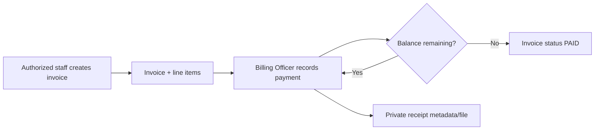

# Modules And Workflows

This document describes executable modules. Exact methods, paths, request models,
and dependency-derived roles are in the [API Reference](05_API_REFERENCE.md).

## Authentication And Sessions

**Purpose:** authenticate staff and bind requests to a durable session and tenant.

**Implemented:** invitation-gated owner onboarding, owner/facility atomic creation,
login by username/email/staff ID, access/refresh JWTs, secure cookies, refresh-token
rotation, one-session logout, logout-everywhere, session listing, password change.

**Rules:** public registration can only request `ADMIN`; a facility cannot be
selected by the caller; production/staging onboarding requires the secret
`X-Onboarding-Token` while public signup is disabled; inactive users and revoked
sessions are rejected.

**Partial:** forgot-password tokens are process-local memory and therefore unsafe
for multiple replicas. Owner email verification, phone verification, MFA,
passkeys, OIDC, SAML, and SCIM are not implemented.

**Models:** `users`, `user_sessions`, `facilities`, `audit_logs`.

## Dashboard

**Purpose:** provide facility-scoped operational counts and recent activity.

The dashboard reads aggregate patient, appointment, laboratory, billing, queue,
and related metrics through `/dashboard` routes. It is an authenticated workspace
view. Query caching and realtime invalidation reduce unnecessary repeat loads, but
the database remains authoritative after reconnect or cache expiry.

**Scaling note:** aggregates must remain tenant-filtered and indexed. High-volume
historical analytics should move to an asynchronous projection rather than adding
large joins to the request path.

## Patient Management

**Purpose:** register, find, view, edit, archive, and inspect a patient's timeline.

**Workflow:**

1. Reception or an authorized clinician submits demographics with one
   `Idempotency-Key`.
2. The server scopes the patient to the authenticated facility and effective branch.
3. Repeating the same key and payload returns the first patient; changing the
   payload with the same key returns `409`.
4. Authorized users can open the record/timeline, edit demographics, and archive.
5. Archive is a soft delete (`is_active=false`); historical clinical and financial
   records remain available to appropriately authorized workflows.

**Rules:** clients cannot choose another facility; branch staff cannot access a
patient outside their branch; lookups return `404` on scope mismatch; list routes
are paginated; patient deletion is not physical.

**Models:** `patients` plus linked appointments, records, orders, prescriptions,
invoices, notifications, queues, referrals, and admissions.

## Appointments And Queue

Appointments track date/time, doctor, duration, reason, notes, branch, and status.
Creation is idempotent and doctor/patient references are tenant checked. Queue
entries track check-in, queue number, priority, department, branch, and lifecycle.
Database constraints prevent multiple active queue entries for the same patient
where the current invariants apply.

Typical flow: appointment scheduled -> patient checked in -> waiting -> in
consultation -> completed. Walk-in queue entries are also supported. Queue and
appointment events can invalidate branch-scoped frontend queries over WebSocket.

**Permissions:** reception, doctors, and administrators manage appointments;
doctors, nurses, reception, and administrators participate in queue actions as
specified per endpoint.

**Models:** `appointments`, `patient_queues`, `patients`, `users`.

## Consultations And Medical Records

Consultation routes coordinate patient context, clinical records, orders, and
timeline events. A medical record stores chief complaint, vitals, symptoms,
diagnosis, plan, prescription/order summaries, follow-up, and notes.

**Lifecycle:** create -> view -> edit -> void. A void operation preserves the row,
reason, actor, and timestamp. There is no physical clinical-record deletion route.
Create operations are idempotent. Clinical notes may be linked to a record.

**Permissions:** doctors lead creation and treatment decisions; nurses have
selected read/write access; administrators and branch administrators have the
explicit route permissions shown in the API reference.

**Models:** `medical_records`, `clinical_notes`, `order_workflow_events`.

## Laboratory

Facility administrators maintain a tenant-scoped test catalogue. Authorized
clinicians create a lab order for a tenant/branch patient. Laboratory staff collect,
process, and record results; doctors and permitted staff can review them.

**Rules:** test codes are unique inside a facility; order creation is idempotent;
patient, test, performer, and branch are validated; result completion uses locking
and database invariants to prevent competing final results; status transitions are
validated by route/service logic.

**Models:** `lab_tests`, `lab_orders`, `lab_results`, `order_workflow_events`,
`patient_notifications`.

## Pharmacy

The medication catalogue is tenant-scoped. Pharmacy stock is one current row per
medication. A doctor creates an idempotent prescription with one or more items.
A pharmacist dispenses under row locks; stock is checked and decremented once,
items are marked dispensed, and the prescription closes.

Stock receipt (`POST /pharmacy/inventory/{medication_id}`) is protected by a
durable idempotency claim and medication-row serialization. Retrying the same key
does not add stock twice.

**Limit:** current pharmacy inventory is facility-level and one-row-per-medication;
it is not a branch/batch movement ledger. Batch number and expiry describe the
current row rather than preserving every receipt lot.

**Models:** `medications`, `pharmacy_inventory`, `prescriptions`,
`prescription_items`, `order_workflow_events`.

## Radiology

Authorized clinicians create branch-scoped imaging orders by modality/body part.
Radiology staff and clinicians process status and report results according to route
roles. Create is durably idempotent; patient and branch access are checked before
the order is returned or modified.

**Gap:** backend routes reference `RADIOLOGIST`, but that role cannot yet be
created through the supported staff-management contract or either frontend.

**Models:** `radiology_orders`, `order_workflow_events`, patient notifications.

## Billing And Payments

**Purpose:** create an invoice, collect one or more payments, and retrieve a receipt.

Invoice totals are calculated from line items, tax, and discount. Creation requires
an idempotency key. Payments require a separate idempotency key, lock the invoice,
and reject non-positive amounts and overpayment. A replay returns the original
payment instead of charging twice. Receipts are stored outside the public static
tree and downloaded only after invoice tenant/branch authorization.

**Permissions:** `BILLING` (shown as Billing Officer), reception, and administrators
manage normal billing actions; doctors/nurses have selected invoice visibility or
creation rights where explicitly declared. Billing reports include the Billing
Officer role.

**Models:** `invoices`, `invoice_items`, `payments`. Legacy insurance models are
not tenant scoped and are not an approved production billing feature.

## Wards And Nursing

Facility-level beds have available, occupied, or maintenance state. Admissions
track patient, ward, optional bed, acuity, observations, nursing notes, and
discharge. Active-patient and active-bed unique indexes plus row locks protect
concurrent admission. Admission, observation, and discharge actions are
idempotency guarded.

**Isolation rule:** branch-scoped staff can work with admissions for patients in
their branch, but cannot assign facility-level beds. Full branch-owned bed modeling
is not implemented; this is a launch limitation for multi-branch inpatient use.

**Models:** `ward_beds`, `ward_admissions`, `patients`.

## Inventory And Suppliers

Inventory tracks facility-scoped supplies/equipment, SKU, stock, reorder settings,
expiry, supplier, and cost. Additive/reductive stock updates require idempotency,
lock the row, reject negative quantities, and reject reductions beyond stock.
Active SKU uniqueness is enforced per facility. Deactivation is a soft delete and
is blocked while stock remains.

Suppliers are tenant-scoped and can be listed, created, edited, and deactivated.
Create is idempotent and active names are unique per facility. Supplier creation
is audited transactionally.

**Partial:** reorder creation returns a confirmation but does not persist purchase
orders or supplier delivery workflows. Backend permissions reference
`STORE_KEEPER`, but supported staff creation does not expose that role.

**Models:** `inventory`, `suppliers`, `write_idempotency_records`.

## Staff, Facilities, Branches, And Modules

Administrators configure facility details, enabled modules, departments, staff,
branches, and public profile. Staff IDs and temporary password flows are generated
server-side. Role creation is checked against enabled modules.

`BRANCH_ADMIN` and the `Administration` department are rejected until the facility
type enables multi-branch mode. Branch modules can narrow enabled functionality.
The backend accepts immutable branch IDs and retains department fields for legacy
compatibility.

**Supported staff roles:** facility admin, branch admin (multi-branch only), doctor,
nurse, receptionist, pharmacist, laboratory staff, Billing Officer.

**Models:** `facilities`, `branches`, `users`, `hospital_listings`.

## Data Migration

Administrators can validate and queue CSV or JSON imports for patients, staff,
appointments, inventory, or a full archive mode. Source aliases exist for generic,
OpenMRS, Bahmni, DHIS2, and other HIS exports. Uploads are limited to 25 MB and
50,000 rows. Validation occurs before import; the import is idempotently queued in
`background_jobs`; job status is polled from a tenant-scoped endpoint.

**Required operating process:** export -> retain encrypted original -> validate ->
review errors/mapping -> run import in staging -> reconcile counts/samples -> take
backup -> import production -> reconcile and sign off.

**Implementation note:** `excel` is accepted as a source label, but the parser
currently accepts CSV or JSON file formats, not native `.xlsx` workbooks.

## Alerts, Tasks, Referrals, And Staff Chat

- **Alerts:** personal or facility-wide alerts, role fanout, read/unread state,
  tenant/branch recipient checks, idempotent creation, bulk mark-read update.
- **Tasks:** role-targeted operational task views derived from module state.
- **Referrals:** department referral creation, acceptance, and completion with
  recipient alerts; create is idempotent.
- **Staff chat:** tenant-only two-person conversations, messages, unread counts,
  presence approximation, and private scanned attachments. Message send is
  idempotent and attachment references must point to tenant private chat storage.

Role-alert fanout and referral notifications are currently created synchronously.
Very large facilities should move fanout to the durable job queue.

## Reports And Audit Logs

Reports expose tenant-filtered operational, billing, clinical, and inventory views.
Audit logs record security and business events with actor, action, resource,
tenant, request IP/user agent, and details. Audit access is facility-admin only.

Some reports perform request-time aggregation. Inventory reporting still needs a
fully bounded/export-worker path for very large catalogues. Audit and report data
must never be queried without facility scope.

## Files, Public Profile, And Realtime

Clinical/general uploads are size/type/signature checked, malware scanned when
required, stored privately, and downloaded after tenant/branch authorization.
Payment receipts and chat attachments use separate private roots.

The public hospital profile exposes only approved listing data, not internal
facility configuration or patient/staff records. Realtime WebSockets authorize
the user and filter events by tenant, branch, role, module, or user before delivery.
