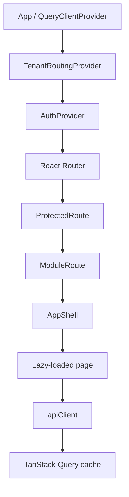

# Frontend Reference

## Applications

HIS.Pro keeps two independent Vite applications. The current UI is under
`app/templates/initial frontend`; the future UI/UX version is under
`app/templates/frontend-v2`. They intentionally share API and route concepts but
do not import each other's code. `app/static` is the built artifact served by
FastAPI and must be updated through the selected release build process.

## Application Composition

`ProtectedRoute` prevents unauthenticated or disallowed roles from rendering a
page. `ModuleRoute` enforces enabled module UX. These are not security boundaries;
the FastAPI dependencies repeat authorization server-side.

## Route Families

On a canonical tenant host such as `sunrise-medical.app.his.pro`, workspace routes
do not contain the facility slug:

- `/login`
- `/dashboard`
- `/dashboard/patients`
- `/branches/:branchSlug/dashboard/...`
- `/portal`

Legacy routes such as `/dashboard/:facilitySlug` and
`/:facilitySlug/branches/:branchSlug/dashboard` remain registered for compatibility
and are normalized/redirected to canonical routes when the tenant host is known.

## Public And Onboarding Pages

| Route | Page | Purpose and behavior |
|---|---|---|
| `/` | `Index` | Public product landing page on the root host; tenant hosts render login |
| `/get-started` | `GetStarted` | Collect owner/facility details and optional pilot invitation code |
| `/setting-up` | `SettingUp` | Calls atomic `/auth/onboard`, shows real progress/success/retry state |
| `/workspace-ready` | `WorkspaceReady` | Displays the created workspace and canonical links |
| `/login` and legacy variants | `Login` | Staff/owner authentication with facility/branch context |
| `/hospital` and legacy variants | `PublicHospital` | Public approved hospital listing |
| `/privacy` | `PrivacyPolicy` | Product privacy content |
| `/terms` | `TermsOfService` | Product terms content |
| `/dpa` | `DataProcessingAgreement` | Data processing content |
| `*` | `NotFound` | Unknown-route fallback |

The invitation token is passed in navigation state and sent only in
`X-Onboarding-Token`; it is not written into the persisted facility workspace.
Onboarding does not simulate timed setup stages and does not claim regulatory
certification.

## Workspace Pages

The route prefix is `/dashboard` on a tenant host or
`/branches/:branchSlug/dashboard` for a branch.

| Suffix | Page | Main API areas | Route guard |
|---|---|---|---|
| `/` | `Dashboard` | dashboard aggregates, recent activity | admin workspace |
| `/staff` | `StaffAccess` | facility staff, branches, departments | admin |
| `/patients` | `Patients` | patients create/list/view/edit/archive | patient roles + reception/records module |
| `/patients/:patientId/timeline` | `PatientTimeline` | unified patient timeline | patient roles + module |
| `/appointments` | `Appointments` | appointments | admin, branch admin, reception, doctor |
| `/queue` | `Queue` | patient queue and check-in | reception/clinical queue roles |
| `/consultations` | `Consultations` | consultations, records, orders | admin, branch admin, doctor |
| `/records` | `MedicalRecords` | EMR view/edit/void | admin, branch admin, doctor, nurse |
| `/laboratory` | `Laboratory` | tests, orders, results | lab module roles |
| `/pharmacy` | `Pharmacy` | medications, stock, prescriptions, dispense | pharmacy roles |
| `/radiology` | `Radiology` | imaging orders and reports | current UI: admin/branch admin/doctor |
| `/billing` | `Billing` | invoices, payments, receipts | admin/branch admin/reception/Billing Officer |
| `/wards` | `Wards` | beds, admissions, observations, discharge | nursing roles |
| `/inventory` | `Inventory` | inventory catalogue and stock | admin/pharmacist in current UI |
| `/suppliers` | `Suppliers` | supplier CRUD | inventory roles |
| `/reports` | `Reports` | operational reports | admin/branch admin in current UI |
| `/alerts` | `Alerts` | alerts and read state | supported clinical/admin/billing roles |
| `/chat` | `Chat` | staff conversations, messages, attachments | supported staff roles |
| `/audit-logs` | `AuditLogs` | tenant audit log | facility admin |
| `/settings` | `Settings` | facility/modules/branches/migration | admin |
| `/public-profile` | `PublicProfile` | public listing editor | facility admin |

`/portal` and branch variants render `StaffPortal`, a role-aware launch surface
whose actions navigate to the same guarded module pages.

## State Management

- **Server state:** TanStack Query caches reads, controls loading/error states, and
  invalidates relevant keys after mutations or realtime events.
- **Authentication state:** access token stays in memory; refresh token is an
  HttpOnly cookie; non-secret user routing metadata is stored in local storage.
- **Tenant state:** `TenantRoutingContext` derives the canonical subdomain, legacy
  facility slug, branch path, and redirect target.
- **Form state:** pages use controlled React state and, where present,
  React Hook Form/Zod schema validation. Backend Pydantic validation remains final.
- **Workspace state:** facility helpers map backend upper-case roles and legacy
  department fields to frontend role/branch types.

## API Client Behavior

The shared client builds `/api/v1` URLs, sends credentials, attaches the in-memory
bearer token, and adds the double-submit CSRF token on unsafe methods. Every unsafe
action gets a unique `Idempotency-Key` unless the caller supplies one. A retry after
token refresh reuses the same serialized body and fully prepared headers, so an
additive action cannot silently become a second operation.

Only one refresh request is active at a time. A failed refresh clears local auth
state and emits `hispro:auth-expired`. Error bodies are logged for developers, but
only short safe messages or status-based fallbacks are shown to users.

## Forms And Validation

Patient, staff, invoice, payment, order, stock, and onboarding forms disable or
lock their submit action while a request is in flight. The backend still provides
the durable duplicate-write boundary. Select/dropdown controls use scrollable
content so long department/role lists remain visible within the viewport.

Staff role options are module-aware. `Branch Admin` and the `Administration`
department are omitted until multi-branch mode is enabled; the backend rejects a
forged request as well. `Billing Officer` is available when billing is enabled.

## Navigation And Quick Actions

Dashboard and staff-portal quick actions use React Router navigation rather than
plain anchors or form submissions. Patient Lookup, Write Prescription, Order Lab
Test, and related commands open their intended module/context instead of reloading
the SPA. Unknown or unauthorized targets are blocked by route/module guards and
then by the API.

## Realtime Updates And Fetching

Returning to a page may issue a network request when its query is stale; that is a
correct recovery path, not the primary update mechanism. WebSocket tenant events
invalidate affected queries immediately. Initial loads, reconnects, missed events,
manual refresh, and cache expiry still fetch authoritative data. Realtime is an
optimization, not a replacement for database reads.

## Error And Empty States

Route pages distinguish loading, empty, permission, validation, and unexpected
error states. Mutations surface a toast/dialog and keep entered data where safe.
Network retries do not create a new idempotency key. Sensitive backend stack,
database, and validation internals are filtered by the API client.

## Frontend Implementation Notes

- The frontend role union does not expose backend-referenced `RADIOLOGIST` or
  `STORE_KEEPER`; this must be reconciled before those roles are advertised.
- V2 dependency scanning previously reported high/moderate advisories. Run a
  current package-manager audit, review breaking upgrades, and record evidence
  before release.
- Full Playwright role/action coverage across both frontends remains a launch gate.
- The current and V2 applications duplicate significant domain mapping code.
  A versioned internal package could reduce drift after V2 stabilizes, but should
  not be introduced during the launch freeze without regression evidence.
