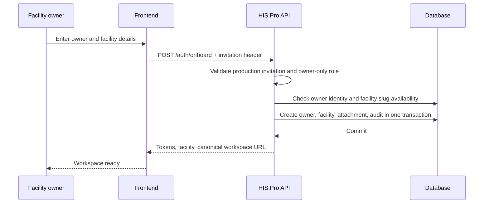
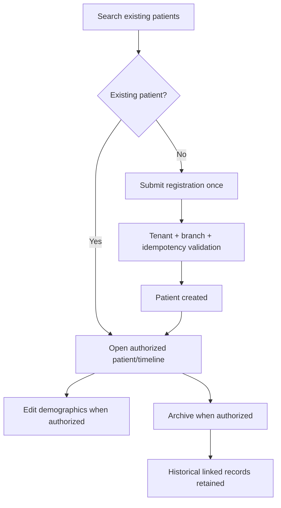
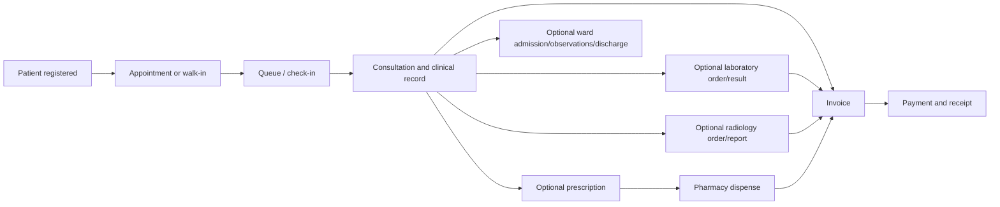
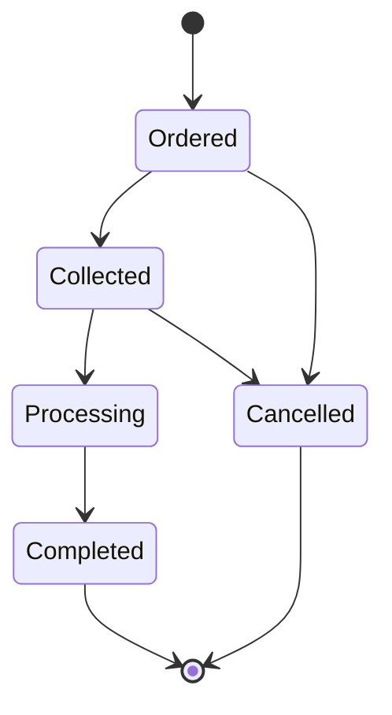
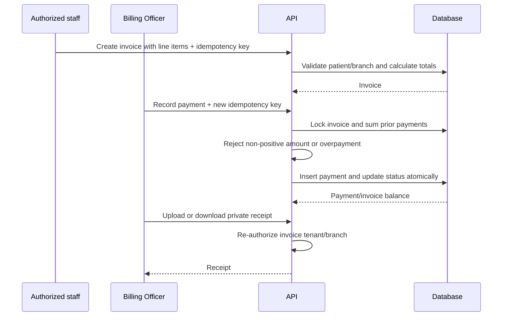
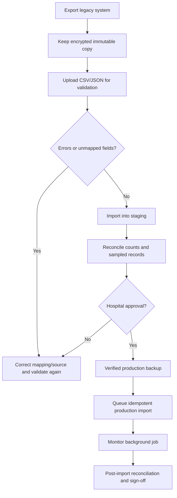

# Business Rules And User Workflows

## Authority Model

Every business action is evaluated against the authenticated user, immutable
facility UUID, enabled module, role, and effective branch. A facility slug,
subdomain, query parameter, request body, or hidden frontend route is never enough
to authorize access.

The table below is a workflow summary. Endpoint-level roles in the generated
[API Reference](05_API_REFERENCE.md) are authoritative.

| Role | Normal operational scope |
|---|---|
| `ADMIN` | Facility-wide administration and explicitly permitted clinical/financial actions |
| `BRANCH_ADMIN` | Enabled multi-branch workspace and branch-scoped records |
| `DOCTOR` | Patients, appointments, consultations, records, prescriptions, orders |
| `NURSE` | Patients, queue, records, wards/observations, selected orders |
| `RECEPTIONIST` | Registration, appointments, queue, selected billing/referrals |
| `BILLING` | Patient billing lookup, invoices, payments, receipts, billing reports |
| `PHARMACIST` | Medications, pharmacy stock, prescriptions, dispensing, selected inventory |
| `LAB_TECH` | Laboratory catalogue/order/result workflow |

## Cross-Cutting Rules

1. **Tenant ownership:** every exposed patient, clinical, payment, staff, file, and
   event lookup is constrained to the current facility.
2. **Branch ownership:** branch staff only receive branch-aware records in their
   permitted branches; inaccessible identifiers generally return `404`.
3. **Module entitlement:** a role cannot be created for a disabled required module.
4. **Multi-branch roles:** `BRANCH_ADMIN` and `Administration` department require
   multi-branch facility mode.
5. **Duplicate writes:** one user action uses one idempotency key. Same key/same
   payload replays; same key/different payload or actor returns `409`.
6. **Concurrency:** money, stock, dispensing, active admission, queue, and final
   diagnostic writes use row locks and/or database uniqueness.
7. **Clinical history:** patient and record removal is archival/voiding, not physical
   deletion from the operational database.
8. **Financial integrity:** payments must be positive, cannot exceed balance, and
   cannot be applied twice by retry.
9. **Private files:** receipt/chat/clinical files are not public static URLs and
   require a fresh authorized download request.
10. **Audit:** privileged, clinical-history, financial, staff, migration, and
    security actions must leave a tenant audit trail.

## Owner Onboarding

Production public signup remains off until owner email verification exists. A
retry with the same valid owner credentials/facility can return the existing owned
workspace; it cannot take over another user's facility.

## Staff Creation

1. Facility admin opens Staff Access.
2. UI loads facility modules, departments, and branches.
3. UI hides roles that are not valid for the current configuration.
4. Admin enters staff identity/contact, role, and branch/department.
5. Backend repeats role/module/multi-branch validation.
6. Backend generates a tenant-unique staff login ID and stores a password hash.
7. Temporary credentials are shown through the supported response/workflow and
   `must_change_password` can force change.
8. Creation/update/deactivation is audited.

Billing staff require the billing module and the `Billing Officer` role. A normal
facility admin role is not required for daily payment collection.

## Patient Registration And Maintenance

The interface locks the create action while pending; the server is still the
duplicate boundary. Staff should search by identifying details before creating a
new patient. Archive should only occur under hospital policy and does not erase
medical/financial history.

## Implemented Care Journey

HIS.Pro supports the following connected path, but not every patient must follow
every optional diagnostic or inpatient step:

There is no single transaction that automatically advances the entire diagram.
Each module owns its state and role checks; order-workflow events and the patient
timeline link the stages.

## Appointment And Queue Workflow

- Appointment creation validates patient, doctor, tenant, branch, and schedule data.
- Check-in creates one active queue entry under database uniqueness/idempotency.
- Priority and queue number drive waiting order; status changes record start and
  completion timestamps.
- Branch staff cannot pull another branch's patient into their queue.
- Repeated navigation may fetch stale data; realtime events prompt faster refresh.

## Consultation And Record Workflow

1. Doctor opens an authorized patient from queue/appointment context.
2. Clinical data is submitted as an idempotent medical record.
3. Doctor may create lab, radiology, or prescription orders from the consultation.
4. Authorized staff can review and amend allowed fields.
5. Incorrect records are voided with reason/actor/time; they are not deleted.
6. Timeline displays linked clinical and workflow history.

Clinical data must not be copied into alert, WebSocket, metric, or audit free text
unless the destination's sensitivity and retention are approved.

## Laboratory Workflow

The exact accepted statuses/transitions are enforced by current route/service
code. A result belongs to one tenant-scoped order. Competing completion attempts
are serialized and cannot silently replace another result.

## Pharmacy Workflow

1. Admin maintains facility medication catalogue.
2. Authorized pharmacy staff receive stock using one idempotency key.
3. Doctor creates an idempotent prescription for an authorized patient.
4. Pharmacist opens a pending prescription in permitted scope.
5. Server locks prescription and stock rows, checks every item, then decrements all
   stock and marks items/prescription dispensed in one transaction.
6. Insufficient stock aborts the dispense rather than partially dispensing.

Current stock is facility-level. A hospital requiring branch or lot-level pharmacy
accounting must not assume that capability exists.

## Billing Workflow

An invoice may receive partial payments until its balance reaches zero. Reference
numbers, methods, notes, and receipt metadata are stored per payment. Payment rows
are not deleted through the supported API. Refund/credit-note accounting is not
implemented and must be handled under a documented interim policy rather than by
editing historical payments.

## Ward Workflow

1. Authorized clinician/nurse selects an active patient.
2. Server locks the patient and optional facility bed.
3. One active admission per patient and one active patient per bed are enforced.
4. Observations append under an admission row lock and idempotency claim.
5. Discharge closes the admission, releases the bed, and creates a follow-up
   notification record once.

Branch staff can admit their branch patient without a bed, but cannot assign the
current facility-level bed model. Multi-branch inpatient rollout is blocked until
branch-owned beds are implemented and migrated.

## Inventory Workflow

- Create a tenant SKU and optional supplier.
- Receive/set/reduce stock with a non-negative amount.
- Add/reduce operations lock the row and use durable idempotency.
- Reduction cannot make stock negative.
- Low-stock queries compare current stock with reorder level.
- Deactivation is blocked while current stock is positive.
- Reorder confirmation is currently a placeholder; no purchase order is persisted.

## Data Migration Workflow

Only facility admins can validate/import/query jobs. Source files contain sensitive
data and must be encrypted, access logged, retained for the shortest approved
period, and securely destroyed after reconciliation/legal retention.

## Deactivation, Void, And Deletion

| Resource | Supported behavior |
|---|---|
| Patient | Archive/soft deactivate |
| Medical record | Void with reason, actor, timestamp |
| Staff | Deactivate; sessions should be revoked |
| Inventory/supplier/catalogue | Soft deactivate subject to domain rules |
| Alert | Admin physical delete is implemented |
| Invoice/payment | No ordinary physical delete workflow |
| Uploaded files | Access-controlled lifecycle; formal retention purge is incomplete |

Retention and legal-hold policy must be approved by the hospital/data controller.
Application delete buttons alone are not a complete privacy-erasure process.

## Downtime And Reconciliation Rule

If HIS.Pro, database, network, or identity service is unavailable, clinical teams
use approved numbered downtime forms. On restoration, one authorized operator
enters each event using original timestamps/source references; another reviews
high-risk medication, result, admission, and payment entries. Duplicate searches
and idempotency keys are still required during backlog entry.
